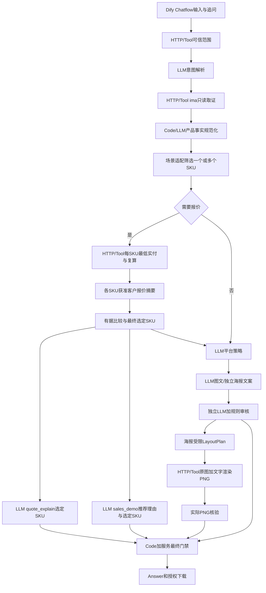

# 多模型接入与专用技能协作设计

> v1.4当前执行基线：用户已授权继续本机Dify安装及业务搭建、修订提示词和准备参赛提交材料；先前“仅交文档”的范围已被后续指令扩展。知识来源采用用户确认的本地v7开发＋参赛ima实时/关联核验双模式，详见[知识源模式](knowledge-source-modes.md)。节点System与变量绑定以[提示词绑定指南](dify-prompt-binding-guide.md)、[提示词登记](../specs/prompt-registry.json)为准。不能用本地读取冒充API达标；实现、离线测试、平台导入、真实运行和参赛验收分别记录。

版本 v1.3　核验日期 2026 年 10 月 18 日

本设计配合[需求与设计主文档](requirements-design.md)。实施基线为 **用户本机Mac自部署Dify Chatflow + 小型业务工具服务**：供应商在平台设置中配置，各LLM节点绑定实际型号；工具服务承担ima只读、确定性报价、PNG渲染/受控下载及必要身份授权。Coze是目标账号资格核实后的条件替代。完整自研React前端、通用Agent平台、模型管理后台和独立模型网关不再是默认必交项。

## 1 模型分工与首版范围

首版以平台中获准且可调用的至少 **2种不同实际模型**完成同一真实任务的生成与独立审核，可来自同一供应商；不要求为清单购买多家服务。相同实际模型的两个别名、参数或提示词不算两种模型；同一基础模型的不同部署最多称不同部署复核，不宣传异构模型独立性。

解析、提取和策划可复用模型A，写作使用模型B，独立审核优先与当前写手使用不同实际模型。视觉理解与图像生成分别按能力、授权和预算接入。模型数量不等于Agent数量，也不要求每一步调用模型。

| 节点/能力 | 平台实现及输入输出 | 不交给模型决定的事项 |
| --- | --- | --- |
| intent_parse | LLM/Parameter Extractor：需求→意图、缺口、追问 | 不猜产品事实、不鉴权 |
| 场景适配/候选推荐 | LLM辅助 + 规则核对：任务硬约束/已核实证据→一个或多个适配候选、理由/待验证项 | 不为低价牺牲任务门槛，不凭记忆补兼容性；节点名/字段按主指南与唯一合同 |
| ima_retrieve | HTTP/Tool→服务：型号/任务→事实、资产及来源 | 官方只读、分页、空搜索目录回退与源权限由服务执行 |
| fact_extract | LLM辅助提取 + Code/服务规范化产品证据 | 不从记忆补事实，不把机密价格规则送入通用写作上下文 |
| platform_strategy | LLM：已证实事实、人群、场景→冻结策略 | 平台硬要求、图片来源和权限不得放宽 |
| article_write | LLM：策略、事实、配图计划→公众号/小红书/朋友圈稿 | 不换未经确认的型号、报价或图片 |
| poster_copy | 独立海报提示词 + LLM：标题、副标题、最多3卖点、CTA | 不生成产品原图，不隐藏必要价格条件 |
| quote_solve | HTTP/Tool→确定性报价服务 | 模型不计算；规则、资格、互斥、有效期与最低实付由服务验证求解 |
| quote_explain | LLM：授权冻结的customer_quote_ref摘要→顾客报价解释 | 不见内部底价、成本、返利、审批，不算价、不改金额/资格 |
| sales_demo | LLM：产品证据、演示动作、同一顾客摘要→3分钟逐字稿 | 不算价、不见内部定价，不伪造演示结果、计时或资格 |
| visual_layout | LLM/模板：已核验文字、原图信息→受限LayoutPlan | 不执行任意HTML/JS/CSS，不暗改文字与资产 |
| fact_compliance_review | 独立LLM + Code/服务：原证据、稿件、顾客摘要→逐项Finding | 不靠自评/投票放行，不接收内部定价全表 |
| poster_render | HTTP/Tool→服务：原产品图层 + 可编辑文字→真实PNG | 字体、原比例、安全边距、文件/内容版本由代码控制 |
| visual_review | 视觉LLM + OCR/布局规则：实际PNG→疑似漏字/遮挡/比例问题 | 外观相似不证明SKU，OCR不证明产品事实 |
| final_gate/export | Code + 服务：所有必需产物与当前依赖→授权输出 | 权限、金额一致、有效期、哈希、下载由代码决定 |

“满足销售规则后顾客实付最低”已是确定目标。四级名称已由用户确认（user_confirmed）：基准价 / 平台优惠 / 身份权益 / 换新国补；清单不代表执行顺序、全享或叠加。已读P4合规/渠道报价/建议零售价三份仍为v0.1空模板，实际规则、顺序、资格和数字待ima来源核验。现在可交报价合同、失败分支及内部绑定模板，不能交虚构真实最优报价。缺报价不阻断独立的无价格营销任务；以报价为核心的解释/脚本不得用占位金额冒充成品。

场景适配优先于算价：先按真实任务、系统软件、设备等必要约束筛选一个或多个候选，再每SKU独立计算最低实付，在可比条件下说明差异与推荐理由。跨SKU价格高低不是适配结论；事实、条件和报价引用不混用。选定SKU后，quote_explain和sales_demo只消费该SKU冻结客户摘要；改选则相关稿件、海报、脚本重绑定/核验。

本机自部署不等于模型也本地运行或资料绝不外发，云模型、ima、插件仍有网络与授权边界。部署正在推进，启动、版本、节点和运行结果由实际记录补充，本文不先声称完成。

## 2 原生配置与保留合同

以下是逻辑合同，可映射到平台设置、节点与配置清单；**不要求每个合同都建表、建API或另做管理页面**。

| 合同 | Dify基线映射 | 保留信息 |
| --- | --- | --- |
| ProviderConnection | Integrations→Model Provider的供应商/凭证/地域 | Provider、审核过的服务目标/地域、秘密引用、允许外发资料范围与版本 |
| ModelProfile | 实际模型/部署与参数；需要时LLM类型环境变量复用 | 实际ID、能力、输入输出限制、结构模式、参数、计费口径 |
| NodeRoutingPolicy | 各节点模型绑定、错误分支和允许备选 | 节点/平台/场景、主备、prompt/Schema版本、数据范围、超时/重试 |
| RuntimeSkill | 节点提示词、变量映射、Schema、模板/规则、工具白名单 | 可审查版本、适用节点/平台、能力要求与测试集，不执行任意Markdown命令 |
| ArtifactEnvelope / NodeRun | 平台run/node trace + 服务产物/依赖记录 | 可信scope/task/run引用、输入版本、实际模型、哈希、父依赖与核验范围；模型不生成可信身份 |

[Dify LLM](https://docs.dify.ai/en/self-host/use-dify/nodes/llm)支持从已配置Provider逐节点选模型，并可用LLM类型环境变量共享模型设置；结构化能力按具体模型区分。下游仍校验Schema和业务约束，JSON可解析不代表事实正确。

[Dify Model Providers](https://docs.dify.ai/en/self-host/use-dify/workspace/model-providers)说明模型及Key共享于workspace，由Owner/Admin管理；workspace协作权限不自动实现门店资料隔离。普通店员使用获准发布应用，不授予跨门店编辑/日志权限。

### 2.1 绑定清单和版本

逐节点记录：平台/实例版本、App/发布版本、业务节点名、实际Provider/model ID或部署、参数、prompt/Schema版本、输入数据范围、备选、超时/重试、用量计费来源和验证结果。Key只记秘密引用或待配置，不写真实值。角色换模型与换提示词分别记版本。

发布后不得悄悄改变在途任务有效模型；平台无法证明运行配置快照时，发布前结束/中止在途任务，并在服务中核对依赖。安全撤销和源权限失效仍立即阻断后续访问。既有[路由样例](../specs/model-routing.example.json)是业务合同/占位配置参考，**不是Dify DSL、Coze导入包或已连通配置**，不为使用样例强制开发路由器。

### 2.2 网关按需增加

平台能力足够时直接使用原生Provider与节点设置。只有需要平台没有的协议、自托管受控地址、数据政策路由、业务费用预留或特殊图像恢复时，才在同一小型工具服务增加适配模块，不必拆常驻微服务。

可选网关保留固定/审核过的endpoint、Secret托管、能力校验、错误归类、实际模型/请求身份、usage/费用未知、有限备选及版本。用户和模型不能输入任意地址、model ID或Key。权限/地域/内容安全拒绝或不允许资料外发时停止，不能换一家绕过；网络/频控等才按已授权同等能力回退。

旧“至少2家供应商、4个配置”改为按需扩展参考，不再是首版购买或重建管理平台的条件。若交付明确含跨供应商故障切换，再做对应真实合同/故障测试；缺第二家凭证记未验证，不靠别名冒充。

## 3 节点协作和小型工具服务

图示表达依赖和可选能力，不要求所有任务执行全部分支。不请求报价/脚本则跳过；无有效顾客摘要时不运行报价解释或生成带金额脚本。文章不强制海报PNG链，但需图文结构/来源/位置核验。

一个服务即可提供身份范围解析、`/v1/kb/evidence`、`/v1/quotes/solve`及校验/顾客摘要解析、`/v1/renders/poster`和授权产物读取；最终路径以 [业务工具唯一合同](../specs/business-tool-contract.md) 统一。这些是项目工具，不是平台内置端点。[Dify自部署Code](https://docs.dify.ai/en/self-host/use-dify/nodes/code)使用独立sandbox，网络/SSRF代理及依赖按本机安装配置核验；不在Code运行本机ima CLI、安装浏览器或渲染依赖，外部操作用HTTP/Tool。

节点传Intent、EvidenceSet、FactSet、StrategyPlan、ContentDraft、ImagePlan、LayoutPlan、ReviewFinding、RenderArtifact、CustomerQuoteSummary、SalesDemoDraft等版本化结构，保留真实引用。按最小需要传证据，不能以前一模型总结作为唯一真值。机密定价规则/求解证明留有授权的服务端，不进通用文案上下文。

### 3.1 并行与汇聚

先跑通顺序主链，再优化独立分支。策略冻结后文案和配图预案可按已有section槽位并行，汇聚后映射真实正文块；不能引用未产生的text_ref。顾客报价冻结后，quote_explain、sales_demo及获准报价内容可独立生成，最终绑定同一快照。

Variable Aggregator用于互斥分支，不是所有并行审核的join。并行结果由Code/服务逐项检查必需分支齐备、无阻断、版本一致；晚到/已取消/旧快照不得覆盖新稿。[Dify变量聚合](https://docs.dify.ai/en/self-host/use-dify/nodes/variable-aggregator)

### 3.2 独立复核

审核者看当前稿件、必要且获准外发的产品证据/平台内容规则和顾客摘要，P4内部计算规则只由受控服务校验，不只看写手自检。不同模型不等于正确；分歧回证据，冲突不投票消除。修订轮数按主文档限定，不无限换模型。

只有一种实际模型时标同模型分角色复核，多模型专项仍未完成。视觉模型不可用可按显式路线转代码检查及有权限人员实际视觉复核，未运行项不记通过。人工结论只满足对应判断，不豁免无据事实、错图、无权限或过期报价；服务验证审核身份与当前依赖，不仅凭可转交表单链接作为实名审批。

## 4 报价解释与三分钟讲解

quote_explain和sales_demo仅消费授权冻结的 **customer_quote_ref只读顾客摘要**，不得接收内部底价、成本、返利、利润、审批阈值/记录或机密全量候选表。误传机密字段时阻断并修正接口，不让模型自行脱敏继续。

服务先筛适配候选，每SKU在已核验规则/资格/有效期/约束下求顾客实付最低，再有据比较并绑定最终选定SKU。语言节点不复算、换方案、改金额/数量/币种/有效期或猜资格；最低仅限服务声明的当前有效候选域。无实际规则时不报数字，当前P4空模板状态沿用。报价服务的内部证明与客户快照分层，不把全部候选给店员文案节点。

脚本按[三分钟设计](sales-demo-script-design.md)和[专用提示词](../prompts/sales-demo-system.md)生成，含有据推荐理由、最终选定SKU、六段180秒预算、逐字台词、动作、资格/产品验证、最终实付/有效期和CTA。180秒是演练目标，不用模型/网络等待凑时长，顾客长答另计；170—190秒是暂定项目验收建议，实际试讲，不按字数保证。

报价版本/金额/资格/条件/有效期变化使旧解释和脚本失效，服务设置失效并重建/核验，不能只改数字继承旧通过和计时。产品/事实/图片/CTA变化也使相应依赖失效；模型不填可信审核或允许展示状态。

## 5 海报和专用图像能力

海报分为专用文案、布局、确定性渲染、实际视觉核验。LayoutPlan用白名单区域、归一化边界/层级和设计令牌；代码检查边界、碰撞、字号和原图等比，不接受任意执行代码。布局可回退安全模板，事实/报价门禁不降级。

| 策略 | 模型作用 | 最终限制 |
| --- | --- | --- |
| competition_strict默认 | 规划/审核；ima原图加程序几何背景 | 不用生成素材充当产品原图或凑图数 |
| concept_preview可选 | 用获准/合成输入做构图草案 | 标设计草案不可发布，不登记为ima原图 |
| creative_authorized条件扩展 | 有明确许可后生成背景/装饰 | ima产品独立原图层最后合成，AI不计ima图数，比赛允许性另核 |

Qwen-Image/万相、Seedream等是候选，不必首版同时接多家。生成、编辑、视觉理解、原生异步、SSE、多图、取消分别登记；参考图或图层拆分不保证原产品像素身份。不得重画产品后仅凭相似过关。关键文字用可编辑程序文字层，专用模型也不保证无错字。

优先平台已支持的Tool/Provider，不匹配协议才加服务适配。CreativeJob是本地身份，只有供应商有原生异步合同才记provider_task_id并poll/cancel；同步/SSE可队列包装，不虚构供应商取消。ima鉴权URL不直接传模型；外传/AI背景许可未明时关闭相应能力。

## 6 配置、费用与恢复

优先原生Provider、环境变量、节点、版本发布、日志和用量页，不新建六标签模型管理后台、全套连接CRUD或通用技能加载器。普通店员看业务阶段/产物/限制/来源，技术设置由开发/管理员操作。

主备/超时/错误分支先用平台能力；硬任务预算/复杂路线按需服务扩展。模型Key存在平台Provider，服务Key用Secret环境变量，ima/定价/存储秘钥留服务端，不写prompt或DSL。只校验启用且必需依赖，禁用可选图像配置不阻断strict路线。

本机自部署以实际Provider/插件/托管资源账单及本机资源消耗为准；Cloud的credits和Usage Priority仅在迁移Cloud时另核，不能套为本机账本。不同币种、token/张/分辨率不直接相加。usage/价格未知标未知，不填0。请求已发但响应丢失/本地取消不能断言未计费，保留请求ID并避免重复付费生图。需硬预算时网关保守预留/对账，不宣称平台自动实现本项目预算算法。

错误默认值不能假装真实quote或通过。保存、取消、发布、重开、换模型、切平台、换报价和恢复要验证数据状态，不只看截图。

## 7 交付与验收

交付节点说明、变量映射、prompt/Schema、模型绑定清单、工具OpenAPI、测试样本与运行证据。目标实例实际搭建后导出真实DSL并在干净应用导入复测；不猜内部ID后称一键可用。本轮本机部署进行中，当前没有已验收业务画布、DSL导入/导出或付费模型结果；实际部署状态由后续记录补充。

至少验证：两实际模型同任务协作；Schema/事实引用；备选记录与错误不绕过；同模型别名；解释/脚本不见机密且与快照一致；报价更新使旧稿失效；原图/布局/PNG一致；互斥聚合与并行join；超时/重试/费用未知；日志/DSL秘密遮蔽；跨门店篡改被服务拒绝。未纳入基线的自建模型管理页不强制验收。

workspace和平台用户标识不替代业务鉴权。[Dify End User Identity](https://docs.dify.ai/en/api-reference/guides/end-user-identity)明确API的user由调用者提供、平台不认证；服务从真实登录、限定app凭据或签名能力绑定可信scope，不能信用户/模型填写tenant_id。

## 8 官方依据和条件替代

- Dify研究（本机工作底稿）：[Chatflow/Workflow](https://docs.dify.ai/en/self-host/use-dify/build/workflow-chatflow)、[Tools](https://docs.dify.ai/en/self-host/use-dify/workspace/tools)、[HTTP](https://docs.dify.ai/en/self-host/use-dify/nodes/http-request)、[版本管理](https://docs.dify.ai/en/self-host/use-dify/build/version-control)；按目标实例/套餐核验。
- Coze研究（本机工作底稿）：[官方使用说明](https://docs.coze.cn/guides_use_workflow)、[FAQ](https://docs.coze.cn/guides_FAQ)已说明新账号入口调整。中国旧低代码、扣子编程、国际版、Studio各自验证，不混用Dify节点名/DSL。
- 图像研究（本机工作底稿）：[Qwen接口](https://help.aliyun.com/zh/model-studio/qwen-image-generation-and-editing-api-reference)、[文字生成限制](https://help.aliyun.com/zh/model-studio/text-to-image)、[Seedream接口](https://docs.volcengine.com/docs/ark/image-generation-api?lang=zh)。能力文档不等于账号已开通或本任务实测。

这是实施规格，不包含云账号接入、模型质量/费用、真实报价或生成效果已通过的结论。

## v1.4 首批模型与联调条件

用户已确认DeepSeek有API，并授权真实调用预算不设上限；本机尚未配置凭证。文本解析/策划/写作先选DeepSeek。官方当前快速开始列出deepseek-flash与deepseek-v4-pro；具体账号可用模型应在配置后探测，不能沿用旧模型名作已接通证明。[DeepSeek官方接入](https://api-docs.deepseek.com/guides/codex)

推荐阿里云百炼qwen3-vl-plus承担独立文字与视觉审核。官方文档提供图片理解/OCR及多图输入；该推荐不是对本项目准确率的担保。用户目前没有百炼API权限，需自行完成账号/服务开通和密钥配置后验证Dify原生provider及地域端点，不自动接受条款或开付费账户。[千问视觉接口](https://help.aliyun.com/zh/model-studio/vision)

图像生成接口保留但默认关闭；已核验知识库产品原图加确定性排版满足海报方向。模型不能保证中文排版、来源或金额准确，最终仍要文字/像素/事实及金额门禁。未配置独立审核模型前不得把同一模型两次调用宣传为两模型协作。

百炼尚未开通时，最短文本链可先探测DeepSeek的两个不同实际模型：写作deepseek-flash、独立文字审核deepseek-v4-pro；两者均须当前账号和Dify适配器真实可用。该过渡方案不等于视觉节点已实现，Qwen3-VL-Plus图像/海报检查仍待账号配置。不能把两个别名指向同一实际模型算作多模型达标。

用户已确认：qwen-image-3.0-pro用于图片生成/编辑，Qwen3-VL-Plus用于图片审核。两者属于不同接口能力：前者官方接口返回图像，不能拿它替代返回审图结论的视觉理解节点。[千问图像生成编辑接口](https://docs.modelstudio.console.alibabacloud.com/zh/model-studio/qwen-image-generation-and-editing-api-reference)

competition_strict下生成图仅作内部概念预览，不能替代或混作必需的ima图片；正式海报产品原图由确定性渲染器按比例合成。creative_authorized商业扩展另走素材/权利/用途许可与事实审核，不能因模型已选定就自动启用或授予原图改绘权。百炼凭证和实际地域端点仍待用户配置，模型选择不代表已调用成功。
