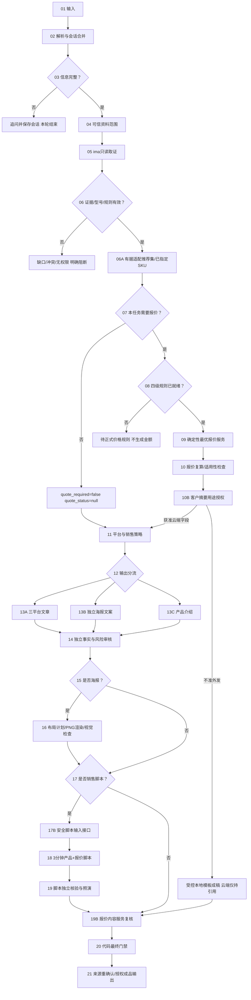

# 节点平台搭建指南：Dify Chatflow 主线

> v1.4当前执行基线：用户已授权继续本机Dify安装及业务搭建、修订提示词和准备参赛提交材料；先前“仅交文档”的范围已被后续指令扩展。知识来源采用用户确认的本地v7开发＋参赛ima实时/关联核验双模式，详见[知识源模式](knowledge-source-modes.md)。节点System与变量绑定以[提示词绑定指南](dify-prompt-binding-guide.md)、[提示词登记](../specs/prompt-registry.json)为准。不能用本地读取冒充API达标；实现、离线测试、平台导入、真实运行和参赛验收分别记录。

版本 1.5（实现状态同步，需求基线仍为 v1.4）　更新日期 2026 年 10 月 18 日　用途：给新手与开发 agent 共用的节点搭建、接入和验证说明。

所有工具路径、报价字段、状态与云外发语义统一引用[业务工具唯一逻辑合同](../specs/business-tool-contract.md)。本指南只解释节点怎么连接，不另定义第二套接口。当前本地取证服务已经实现部分端点，报价与渲染核心已有合成测试；完整 HTTP 适配、授权交付与端到端联调尚未完成，不能把已有核心函数或占位字段当作业务已接通。

主线采用**这台Mac本机自部署的Dify Chatflow**：先问清销售平台、顾客需求、使用场景及报价条件，再生成内容。用户已确认四级名称为**基准价、平台优惠、身份权益、换新国补**；各级具体优惠、计算基数、资格、叠加核算顺序及有效期仍须知识库证据，不把名称列举顺序当计算顺序。报价目标为**同一顾客已核验权益和旧机条件下，本次现金支付最低**：对有据且满足硬需求的推荐产品逐SKU求其最优报价，再做可解释比较，商品结算、抵付与资源消耗分别展示。脚本为**新店员向顾客介绍产品并讲解报价的约3分钟销售脚本**。

当前本地 v7 审计的 P4 共20份文件均为空模板；此前在 ima 客户端完整读到的《对外报价合规检查.md》《渠道报价登记.md》《建议零售价快照.md》也未提供可执行规则。此结论限定于已审计的本地版本和已读条目，不能据此断言共享库永久没有已填记录。商城公开页面的价格或条款还须形成获准、完整、可执行且有时效的规则，不能直接拿页面价算出最低。price4_pending_source表示**已确认名称、待核验执行规则**，FourLevelsSpec.source_status仍为pending-source-verification，real_quote_enabled=false；不再追问四级名称。

## 0 当前可打开的应用与真实进度

本机 Dify **1.17.1 已安装并完成初始化**，API 健康检查通过。打开[工作室](http://localhost:8080/apps)即可继续当前应用，不需要重新安装或再创建同名应用。以下是本机编辑入口，尚不是对外发布链接：

| 应用 | 编辑入口 | 当前状态 |
| --- | --- | --- |
| 主应用 | [打开102节点画布](http://localhost:8080/apps) | 正式报价请求已实跑，因P4缺规则明确返回`needs_source`；未发布、未验收 |
| 原产品介绍联调 | [打开19节点画布](http://localhost:8080/apps) | 旧提示词导入快照；首轮缺全局配置限定被审核阻断；未发布 |
| 自动修订产品介绍 | [打开31节点画布](http://localhost:8080/apps) | 历史本地候选通过；最新本地运行因reviewer非法JSON严格阻断；未发布、未导出 |
| 视觉单文件探测 | [打开5节点画布](http://localhost:8080/apps) | Qwen3-VL-Plus识别合成`check.png`的形状、颜色及`K7M4`；不代表产品图审核；未发布 |

早期Dify单步检查：资料范围HTTP成功（0.792秒）、营销降级Code正确阻断（1.486秒）、显式产品介绍Code通过（0.220秒）。之后原链运行`b6b6a550-df7f-475d-9f30-1ea7eb855e01`中Flash写作成功（7.504104秒）、Pro审核成功（98.621833秒），两段缺全局配置限定被拦截。自动修订链运行`d1405d24-7827-4414-acd9-40bf2444804b`完成23步、74,464 tokens、240.955秒并通过第二轮审核；**此成功仅指本地介绍候选，不是报价、图片、导出或参赛验收**。

DeepSeek与通义已配置并真实调用；历史402余额问题已恢复。Flash写作、Pro独立审核成功，Qwen3-VL-Plus只验证合成图；qwen-image-3.0-pro仅离线适配器26项测试，无真实生图。ima单文件原文3,624字节匹配、14事实/0获准图与Dify scope/evidence→writer/review安全receipt输入已验证。hybrid运行`e4d50529-a519-4fe4-a3bb-14cce80d4e4b`为18步、33,339 tokens、85.24687秒，因无证CTA“到店核对”及需人工标记被审核阻断，不是成品通过。

最新本地运行`371b3173-b9c3-4cd2-b9b4-0f0d58d1d35b`为18步、32,359 tokens、85.24225秒，writer完成、reviewer非法JSON严格阻断。已增加单独中文格式失败说明，离线重放仍阻断、不进入修订、不新增模型调用；不宽松修补JSON，未据此归责DeepSeek。主应用正式运行`90c23744-ac94-477b-9316-ad987b93619a`为12步、1,542 tokens、10.164221秒，中文解释四级规则/顾客权益/旧机缺项，不产假价格。

ima当前get_knowledge_list业务码220021（HTTP200）：“资料获取次数已达上限，请明天再尝试”；凭据有效，今日停止继续读取。随后`ec297fca…`在scope阻断，7步、0 tokens、4.736秒。Bridge私有配置明确`default_source_mode=local_snapshot`、`enable_ima_verification=true`，用于继续已批准的本地开发；本地零凭据读取、零ima联网。画布暂无source_mode选择控件，normalizer不让LLM选来源；受控HTTP显式hybrid请求失败不降级，不把旧收据当实时。全库核验、参赛资格与导出均未放行。

31/102节点两个当前画布共10个System（产品介绍1.5、审核1.6）与原文hash精确匹配；9/10种提示词已导入，visual_review尚未导入，详见[登记表](../specs/prompt-registry.json)。12个Code（4 Scope/EVIDENCE＋8格式处理）均已保存、重开/复制核对，并从数据库draft.graph逐字确认；旧19节点是旧快照，不能算当前System同步。

主应用画布已连接自然语言解析、任务校验、资料范围/取证、报价求解→复算→客户购买方案、策略、独立文章/海报文案、事实审核及部分脚本/终审路径。**有连线不等于后端能力可用**：正式报价实跑仍因P4缺可执行规则阻断；`validate/client-view/script-input/verify-content/render/finalize`业务适配未完成。多SKU调度、产品图File/视觉闭环、文章视觉检查、营销视觉后的脚本合流、全库及报价/图片的ima核验、多门店身份隔离和真实规则仍未完成；报价大于95%及导出验收未执行。本轮已用含Pillow的workspace Python完成全套471项测试，全部通过、5.326秒、无跳过；这是离线工程回归，不代表真实报价或完整业务验收。

当前先完成应用，再准备GitHub、魔搭链接和作品说明书。GitHub仓库未创建；[ModelScope创空间](https://modelscope.cn/studios/A1211JOY/huawei-pc-agent)已创建、无部署文件。正式结果组0、133项业务用例NOT_RUN、准确率大于95%未测、未录制视频。后续仍须目标实例导出无密钥DSL、重导入并实跑，不能用当前开发证据替代。

## 1 先认识需要搭的三部分

| 部分 | 谁做、放哪里 | 负责什么 |
| --- | --- | --- |
| 可视化流程 | 在 Dify 画布添加、连线和配置节点 | 追问、选模型、读工具结果、策略、写作、审核、脚本及结果呈现 |
| 小型业务工具服务 | 由开发 agent 实现，HTTP 或自定义工具接入 | 可信门店身份范围、ima 只读取证、确定性报价、PNG 排版和授权下载 |
| 资料与模型配置 | 管理员在获准范围内配置 | ima 凭证、供应商账号、资料外发范围、有效价格规则和模型预算 |

业务工具服务可以是一个服务内的四个模块，不需要四个微服务。不默认重做 React 网站或整套自研平台；只有实际登录、访问控制或业务功能需要时才补最小入口。

Dify 的 Code 节点用于处理传进来的变量。本指南不在其中出网、不运行 `ima_api.cjs`、Shell 或 Playwright，也不把它当 PNG 文件服务器。Cloud 官方说明 Code 在受限沙箱中执行；自部署的网络策略还受部署配置影响。本项目统一用 HTTP/Tool 调用外部小服务，避免依赖沙箱的特殊放行。[Cloud Code](https://docs.dify.ai/en/cloud/use-dify/nodes/code)、[Self-Host Code](https://docs.dify.ai/en/self-host/use-dify/nodes/code)

## 2 先确认入口，再创建应用

1. 使用第0节已部署的Dify 1.17.1和现有4个本地未发布应用，先核对当前画布和用户改动，再继续配置。Cloud不再是待选默认环境。
2. 主应用用于正式营销与购买方案；31节点介绍链验证有限自动修订，19节点链保留首轮阻断证据，5节点应用独立验证视觉文件输入。不要因旧教程要求而重复创建同名应用。Chatflow每轮消息会执行流程；下文会话变量与增量节点仍是目标设计，当前未接通的部分须逐项实现。[Workflow / Chatflow](https://docs.dify.ai/en/cloud/use-dify/build/workflow-chatflow)
3. 先使用草稿与测试运行，不立即公开。业务试用前必须完成第 10 节的发布身份与门店隔离检查。
4. 节点名称按 `01_输入`、`02_解析` 等编号。下面的业务变量名可以照用；节点内部 ID 由平台产生，配置时使用变量选择器，不凭空手写节点 ID。

### 2.1 先配置模型槽位

进入 Integrations → Model Provider，安装或启用实际使用的供应商，再配置获准的账号/Key。每个 LLM 节点右侧可以单独选择模型；同类节点也可绑定同一个 LLM 类型环境变量。模型配置不是把模型名称写进提示词就生效。[Model Providers](https://docs.dify.ai/en/cloud/use-dify/workspace/model-providers)、[LLM](https://docs.dify.ai/en/cloud/use-dify/nodes/llm)

| 槽位名 | 用在哪些节点 | 最低能力与要求 |
| --- | --- | --- |
| `MODEL_PARSE` | 意图解析、事实与规则结构化辅助 | 文本与结构化 JSON；可复用写手或审核模型 |
| `MODEL_STRATEGY` | 平台/场景策略 | 消费当前证据和获准购买方案；可复用合格写手模型 |
| `MODEL_WRITE` | 产品介绍、文章、独立海报文案 | 中文表达与结构化输出；只用已取证事实和只读报价 |
| `MODEL_REVIEW` | 独立事实、商业条件、合规与脚本审核 | 读取原证据；正常多模型路线采用与写手不同的实际模型身份 |
| `MODEL_LAYOUT` | 受限 LayoutPlan | 文本或视觉输入，输出受限区域，不能改写文案；可复用已验证模型 |
| `MODEL_QUOTE` | 已核验报价和购买方案解释 | 不计算金额；可复用合格写手模型 |
| `MODEL_SCRIPT` | 六段180秒销售讲解 | 不新增报价或能力；可复用合格写手模型 |
| `MODEL_VISION`（后续接入） | 真正渲染后的 PNG 检查 | 必须收到实际图片；当前 File 接线未完成，不能仅配模型名称即放行 |

一个模型可以承担多个槽位，两个别名也可能指向同一实际模型。正式多模型验收要证明同一任务确有至少两个不同实际模型完成写作与审核等分工；不要求购买五家服务。图像生成不是本指南最短链的依赖。比赛默认 `competition_strict`，不调用生成图来替代 ima 配图或凑图片数量。

这些名称是开发配置槽位，不等于所有槽位均已接通。当前Flash写作与Pro独立审核已在同一介绍任务真实协作；主图尚未接通产品图视觉闭环。独立视觉探测成功不能替代真实产品/海报审核，任何模型失败均不能伪造调用或降低审核标准。

### 2.2 配置现有应用的环境项

| 名称 | 类型 | 值从哪里来 |
| --- | --- | --- |
| `BUSINESS_SERVICE_BASE` | 普通环境变量 | 开发agent交付并审核的业务服务地址；本机隔离调试可用明确审核的本地HTTP地址，对外访问采用HTTPS |
| `BUSINESS_SERVICE_TOKEN` | Secret | 本应用获准使用的服务凭证；服务端映射权限范围，不由店员填写 |
| `BUSINESS_PURPOSE_REF` | 普通环境变量，主应用使用 | 与服务核准的用途引用一致，引用本身不是授权 |
| `BUSINESS_DESTINATION_REF` | 普通环境变量，主应用使用 | 与服务核准的目的地引用一致，引用本身不是授权 |

当前最短链只声明前两项，主应用声明四项；按各自实际环境面板配置。业务配置版本继续由服务绑定，不能把设计用的 `APP_CONFIG_VERSION` 当成当前画布已存在且已核验的字段。

个人 ima Key 和 Client ID 尽量只保存在小服务的密钥管理中。不要放进开始输入框、system prompt、Code 常量或公开 DSL。Secret 遮蔽能力仍需用假密钥实际检查；不要把 Secret 复制到普通字符串再输出。[HTTP 鉴权与 Secret](https://docs.dify.ai/en/cloud/use-dify/nodes/http-request)

本机自部署只确定编排与存储位置；调用ima、外部模型/provider、插件或其他远端服务仍可能出网，继续执行用途、供应商、地域和字段白名单门禁。本地节点日志也须按门店权限保护，不能因不在Cloud就把P4原文送入任意LLM。

## 3 开始节点、会话变量与固定业务配置

### 3.1 User Input 收集什么

Chatflow 的自然语言来自本轮用户消息；在 User Input 中添加的结构化字段用于首次设置和明确选择。无需把所有字段强制要求用户重复填写，解析后可追问。

| 变量 | 类型/建议选项 | 是否可缺 | 用途 |
| --- | --- | --- | --- |
| `task_kind` | select：`product_intro`、`marketing`、`quote`、`sales_script`、`full_package` | 必须由已确认意图确定；不明确先问 | 区分报价、图片成稿和完整脚本；不能默认成产品介绍绕过正式购买方案 |
| `product_query` | short text | 已指定型号任务随后补齐；推荐任务可先缺 | 产品查询或具体型号描述；推荐任务先从需求/场景形成有据候选，再唯一到SKU |
| `audience` | text | 可缺，随后追问 | 客户人群 |
| `usage_scenario` | paragraph | 可缺，随后追问 | 用途、使用问题和购买阶段 |
| `content_channel` | select：`wechat_article`、`xiaohongshu`、`moments`、`store_poster` | 仅营销成品必需 | 内容发布渠道，四平台含义沿用主规格 |
| `sales_platform` | text/select，候选来自获准业务资料 | 报价前需确定 | 实际销售平台或渠道；不能与 `content_channel` 混用 |
| `quantity` | positive integer | 报价前必需 | 明确购买数量；不得静默按1台 |
| `currency` | text/select，来自适用业务配置并确认 | 报价前必需 | 币种及最小单位；不得静默按人民币 |
| `region` | text/获准配置 | 报价前明确适用范围 | 由规则确认地域或明确不限地域，不自行推断 |
| `as_of` | 带时区的报价时点 | 报价前必需 | 可信服务时间或明确报价时点，显示给用户确认 |
| `rule_timezone` | 规则时区，由真实规则/可信配置确定 | 报价前必需 | 与as_of一起检查活动边界；不用宿主机时区代替 |
| `customer_needs` | paragraph | 推荐比较前确认 | 顾客预算、硬需求、关注点和演示限制；结合usage_scenario筛适配产品，不是产品事实或优惠依据 |

不要提供可编辑的 `tenant_id` 作为认证字段，不收集 ima 密钥。资格证明所需信息应由规则决定且最小化，不能为普通产品介绍要求无关个人资料。

### 3.2 Chatflow 会话变量

在会话变量面板新增confirmed_intent_json、selected_product_ref、recommendation_set_ref、source_context_ref、evidence_set_ref、quote_ref、quote_version、validation_ref、current_artifact_ref，初始为空。多SKU比较另外保存按product_ref绑定的quote引用/版本/状态映射，不能把一个SKU的quote复用给另一款；最终选定后才绑定当前quote_ref。customer_quote_ref是脚本对同一quote_ref的语义别名，不另存第二份可独立修改报价；报价版本必须相同。它们保存引用和意图，不把旧报价当永久有效；云外发未获准时不存金额/内部规则快照。用Variable Assigner更新；需求、场景、推荐集、型号、数量、币种、时点、时区、门店、规则或权限变更后清理受影响引用。[Variable Assigner](https://docs.dify.ai/en/cloud/use-dify/nodes/variable-assigner)

### 3.3 固定业务配置：不是用户可改输入

```json
{
  "pricing_mode": "price4_pending_source",
  "price4_level_names": ["基准价", "平台优惠", "身份权益", "换新国补"],
  "price4_level_names_source": "user_confirmed",
  "price4_definition": null,
  "real_quote_enabled": false,
  "quote_objective": "min_customer_payable",
  "script_type": "customer_product_and_quote",
  "script_target_seconds": 180,
  "asset_policy": "competition_strict"
}
```

`min_customer_payable`与四级名称均已由用户确认；这里price4_definition为null只表示尚无经知识库核验的可执行金额、基数、叠加顺序等定义，不表示四级名称未知。price4_level_names是FourLevelsSpec.levels[].display_name的界面投影，price4_level_names_source投影自name_source，列举顺序不推定核算顺序。P4机密空模板不等于存在可执行规则。只有补齐可核验规则、适用范围和价格并受控发布后，才能开启真实报价；不能由LLM或店员临时填金额把模式改成ready。

price4_pending_source仅是界面投影：请求真实报价对应quote_status=BLOCKED_SOURCE_UNVERIFIED；不报价则quote_required=false且quote_status=null。不要把价格资料状态、包装status、报价quote_status或稿件审核状态混成一个字段。

任务是否要报价由代码推导：`quote`、`sales_script`、`full_package` 为 true；仅显式 `product_intro` 为 false；正式 `marketing` 为 true。用户中途要求加价格，应重新确认意图并走报价分支。**不报价任务不能因 P4 未就绪而被阻断。**

## 4 第一条最短成功链：单型号、只做有据产品介绍

这条链先验证真实变量、工具和两模型协作。19节点原链已真实写作/审核并正确阻断缺条件稿件；31节点扩展链已真实自动修订并通过第二轮审核，输出本地产品介绍候选。**这不证明四平台图文、报价、PNG、获准导出或完整3分钟销售脚本已完成**。产品介绍链先接收严格`task_json`；下面自然语言解析与会话合并是进一步扩展设计，不能据图宣称已经实跑。

先选择 `task_kind=product_intro`，输入一个实际知识库可找到的型号及客户用途；不填价格，不选海报。

19节点原链的实际路径为：`Start(task_json) → normalize → scope HTTP → scope_parse → evidence HTTP → evidence_parse → writer → writer_parse → reviewer → gate → Answer`，中间设有成功条件与失败回复。31节点扩展链增加受限修订与第二次独立审核，当前成功输出仍是候选。继续以此联调正式hybrid取证；下面带自然语言解析的M1—M11是后续扩展示意，不是当前画布的逐一同名截图说明。

```text
M1 User Input → M2 LLM解析 → M3 Code必填检查 → M4 IF完整？
  缺信息 → Answer追问，本轮结束
  完整 → M5 HTTP可信范围/取证 → M6 Code解析业务状态 → M7 IF有证据？
    失败/歧义 → Answer说明缺口或追问
    ready → M8 LLM产品介绍 → M9 LLM独立审核 → M10 Code门禁 → M11 Answer
```

| 节点 | 怎么配置 | 输出及连线 |
| --- | --- | --- |
| M1 User Input | 使用第 3 节字段和本轮消息 | →M2 |
| M2 LLM解析 | 选择 `MODEL_PARSE`；System要求只解析，不补产品事实；启用结构化输出 | `intent` 含 task_kind/product_query/audience/usage_scenario/quote_required/missing_fields →M3 |
| M3 Code必填检查 | 从变量选择器绑定 M2 的 structured_output；仅接受显式product_intro及报价/方案/脚本标记false，其他任务阻断；不能把营销任务改成false降级 | `input_ready`、`questions`、`intent_json` →M4 |
| M4 IF完整 | IF `input_ready=true` →M5；ELSE →追问Answer | 不通过时不调用知识工具或写手 |
| M5 HTTP取证 | POST固定 `/v1/kb/evidence`，鉴权用Secret；body见第 6 节；该最短链由固定应用credential结合已认证发布入口映射门店，不信用户自报门店 | HTTP status/body →M6 |
| M6 Code解析 | 使用第 6 节代码；拆开HTTP状态和业务status | `business_status`、`data_json`、`error_code` →M7 |
| M7 IF有据 | IF status=`ready` →M8；`needs_input` →型号选择追问；其他→安全失败回复 | 空结果不能当资料不存在，目录回退由工具承担 |
| M8 LLM介绍 | `MODEL_WRITE`；只读intent和证据最小片段；输出text与claims，每主张引用fact_id；不写价格/优惠/亲测 | `draft_json` →M9 |
| M9 LLM审核 | `MODEL_REVIEW`；给完整draft和必要原证据，而非只给写手自检；逐条输出支持/不支持/冲突/不确定 | `review_json` →M10 |
| M10 Code门禁 | 校验Schema、引用真实且属本次证据、稿件与审核hash一致；有未支持或冲突就不通过 | `passed`、`final_text`、`blockers` →M11 |
| M11 Answer | passed=true才显示产品介绍和来源标题；否则显示具体缺口 | 不把系统提示词或原文鉴权数据显示给店员 |

第一次成功的证据包括：M5确实返回授权证据；M8/M9确有不同实际模型调用；M10拦截无据内容；M11显示正确介绍。用测试替身时页面标明“模拟”，不能把模拟成功记为真实接入。

## 5 增量扩展为完整主链

在最短链基础上增加报价、四平台、海报和销售脚本，不用推倒重来。以下每行注明Dify节点种类；“Code + IF”表示两个节点。



图中简化了失败连线：任何必需检查失败均走明确缺口或有限修订，不自动流到最终输出。solve形成候选后先进入独立validate；不能要求solve先VALID_OPTIMAL再validate。P4未就绪时，报价/完整销售脚本任务停止报价支路；可以另行选择“只做产品介绍”，但不能把省掉报价的草稿标成用户要求的完整交付。客户可见不代表可送云端：未取得本次purpose/provider/region许可时，云端仅收状态/ref，私密数值与最终稿留本地受控路径。

### 5.1 逐节点输入、输出和下一分支

| 编号/名称 | 节点种类与模型 | 变量输入 | 变量输出 | 下一分支 |
| --- | --- | --- | --- | --- |
| 01 输入 | User Input | 本轮消息、第3节表单 | `raw_input` | →02 |
| 02 解析与合并 | LLM `MODEL_PARSE`，再Code | raw_input、confirmed_intent_json | `intent_json, missing_fields, quote_required, script_required` | →03；用户消息不能覆盖可信门店或业务配置 |
| 03 信息完整 | IF/ELSE | missing_fields、任务所需字段 | ready/needs_input | 缺字段→Variable Assigner保存已知意图→Answer追问；完整→04 |
| 04 可信范围 | HTTP/Tool `/v1/contexts/resolve` | 固定服务credential、实际已认证请求证明、受控purpose_ref/destination_ref；不从自然语言取门店身份 | `source_context_ref, scope_version, status`及安全权限信息 | denied/expired→拒绝；ready→05；purpose/provider/region由服务核准 |
| 05 只读取证 | HTTP/Tool `/v1/kb/evidence` | source_context_ref、型号查询、content_channel、sales_platform、region、as_of、资料需求与用途/目的地 | 默认仅`evidence_set_ref, pricing_schema_status, price_rule_set_ref`等安全状态/ref；获准时才有最小产品事实/图片payload | →06；搜索空由服务回退；P4内部规则/原文不进入云节点，即使报价任务需要读取也由服务内部使用 |
| 06 证据规则检查 | Code + IF/ELSE | 05业务返回、候选型号、任务需要 | `product_ref, input_ready, evidence_status, questions` | 指定型号歧义→追问；冲突/权限失败→阻断；仅缺价格且不报价→仍可06A/07 |
| 06A 适配推荐集 | 需要推荐时：获准事实辅助LLM解释，Code/业务服务校验 | 推荐任务的销售平台、顾客需求、usage_scenario、明确硬需求、当前产品事实与范围 | `recommendation_set_ref`及获准的逐SKU适配证据/未决项 | 硬需求不满足者排除；关键适配事实未知先追问/补证；有据候选→07。已指定SKU且无推荐请求则直接07，不为普通产品介绍额外强求报价条件或替换型号 |
| 07 是否报价 | IF/ELSE | quote_required | 分支 | false设置`quote_status=null, quote_ref=null`→11；true→08；不报价不调用quote接口 |
| 08 价格模式检查 | Code + IF/ELSE | pricing_schema_status、price_rule_set_ref、已核实资格字段 | `pricing_ready, quote_questions, quote_blockers` | `price4_pending_source`→待资料；缺顾客资格→追问；完整可执行→09 |
| 09 最低实付求解 | HTTP/Tool `/v1/quotes/solve`，推荐集逐SKU执行 | source_context_ref、recommendation_set_ref、精确product_ref、quantity、currency、region、sales_platform、as_of、rule_timezone、资格/规则ref、objective固定min_customer_payable、任务版本/幂等键 | 每SKU独立安全`quote_ref, quote_version, quote_status, reason`；内部规则/候选/证明/金额账本留服务端 | 各SKU有quote_ref且FEASIBLE_NOT_PROVEN+PENDING_INDEPENDENT_VALIDATION→10；其他按专用状态处理；不等待VALID_OPTIMAL造成循环 |
| 10 报价独立复核 | HTTP/Tool `/v1/quotes/{quote_ref}/validate`，Code核对响应 | quote_version、task_version_ref、expected_dependency_hash、purpose_ref、destination_ref | `validation_ref, quote_status`及安全检查结果 | 只有严格最优/独立回放/完整业务门禁均通过才提升VALID_OPTIMAL→10B；其他阻断；不能只靠模型复核 |
| 10B 客户摘要授权 | HTTP/Tool `GET /v1/quotes/{quote_ref}/client-view`，每SKU各自验证 | 当前主体、quote_version、purpose_ref、destination_ref | 每SKU的`client_quote_allowed, customer_quote_summary`或null、local_delivery_ref | 获准摘要按统一比较口径展示各SKU最低实付及适配差异；确定产品后绑定其quote_ref送11；无云授权则本地比较/成稿，不回流私密结果 |
| 11 平台策略 | LLM `MODEL_WRITE`或策划模型 | intent、获准FactSet/业务信息/ima资产；仅在本次云用途获准时附CustomerQuoteSummary | `StrategyPlan` | →12；摘要只读，不送P4内部规则。无权外发且必须含价的部分走受控本地模板 |
| 12 任务与渠道分流 | IF/ELSE | task_kind、content_channel | 互斥分支 | 文章三平台→13A；海报→13B；产品介绍/购买方案说明→13C |
| 13A 文章 | LLM `MODEL_WRITE`，article prompt | StrategyPlan、证据、允许图片、可选quote_ref | `ContentDraft, claims, ImagePlan` | 公众号2–4图/小红书3–6图/朋友圈1–3图→14；不足则不冒充完整成稿 |
| 13B 海报文案 | LLM `MODEL_WRITE`，独立poster prompt | 同上、海报容量 | `PosterContentDraft, claims, candidate_layout` | 1张ima主视觉、最多3卖点→14 |
| 13C 产品/报价说明 | LLM `MODEL_WRITE` | 已取证事实、可选本次目的地获准的只读CustomerQuoteSummary | `ContentDraft, claims` | 纯报价无需硬凑营销图片→14；不改变四平台任务自身图数要求 |
| 14 独立审核 | Code规则 + LLM `MODEL_REVIEW` | 实际draft、获准最小产品证据、当前版本hash；报价只传本次审核目的地获准摘要 | `ReviewFinding, content_check_passed, content_hash` | 通过→15；修订最多2轮后重检；P4内部定价由服务复核，不能为审核外发机密 |
| 15 海报判定 | IF/ELSE | content_channel、成品类型、content_check_passed | 分支 | 海报→16；其他→17 |
| 16 布局与PNG | LLM `MODEL_LAYOUT`→HTTP `/v1/renders/poster`→视觉/Code | 已核验draft、受限LayoutPlan、1张ima原图、尺寸、必要最小参考；vision读实际PNG | `render_ref, png_hash, layout_hash, visual_report, render_passed` | 排版失败→布局节点；改文字→回13B并重检；通过→17 |
| 17 脚本判定 | IF/ELSE | script_required、quote_status、validation_ref | 分支 | 不要脚本→19B（无报价则跳过）；完整产品+报价脚本须VALID_OPTIMAL和当前validation→17B；否则缺口 |
| 17B 脚本安全绑定 | HTTP/Tool `/v1/quotes/{quote_ref}/script-input` | quote_version、validation_ref、product_fact_set_ref、customer_need_ref、demo_action_plan_ref、cta_ref、任务版本、purpose/destination | 本次目的地获准的脚本最小payload，或仅本地处理ref | 云端字段获准→18；否则本地确定性模板→19B。customer_quote_ref=quote_ref，不能替换内部报价对象 |
| 18 销售脚本 | LLM `MODEL_WRITE` | 17B获准输入与只读CustomerQuoteSummary、180秒目标；金额仅用formatted_customer_payable | `ScriptPlan`及真实引用 | →19；六段边界0/20/45/85/120/155/180；不能重算/新增优惠 |
| 19 脚本独立审核 | Code + LLM `MODEL_REVIEW`；验收时真人照演 | ScriptPlan、获准事实与摘要、实际动作；审核目的地也需单独授权 | `script_findings, timing_plan` | 仍须→19B服务核验；模型通过不能替代报价内容核对 |
| 19B 报价内容核验 | 有报价时HTTP/Tool `/v1/quotes/{quote_ref}/verify-content`；无报价明确跳过 | quote_version、validation_ref、content/script_ref/hash、任务版本、purpose/destination；私密本地稿只传ref | 受版本绑定的服务核验ref、通过/阻断 | 金额/条件/最优范围/保密不通过→修订重检；通过或明确无报价→20 |
| 20 最终门禁 | Code | 所有必需产物/检查refs和版本；含价须VALID_OPTIMAL、当前validation、19B通过及实际交付用途许可 | `final_ready, final_manifest, blockers` | 全部通过→21；云外发不允许时仅本地交付引用，云端不显示真实金额/成稿；不报价无需quote检查 |
| 21 输出 | HTTP重确认源权限/版本→Template→Answer | final_manifest、源版本确认、授权下载引用 | 正文、报价说明、3分钟脚本、海报PNG及核验摘要（按请求） | 来源更新/撤权→stale_source，重新核验后才能导出 |

互斥文章/海报分支可用 Variable Aggregator统一同类型产物。并行审核必须用Code/Template合并全部结果，Variable Aggregator不是并行结果汇总器。[Variable Aggregator](https://docs.dify.ai/en/cloud/use-dify/nodes/variable-aggregator)、[串行与并行](https://docs.dify.ai/en/cloud/use-dify/build/orchestrate-node)

初学搭建阶段先串行接14、16、19，确认状态正确后再并行独立检查。并行分支不能读彼此尚未产生的变量；共同汇聚时必须核对同一run、输入版本和依赖hash。不要让布局模型提前引用还没生成的文案块。

### 5.2 推荐集与逐SKU报价怎么衔接

先固定销售平台、顾客需求与场景，以知识库事实形成适配推荐集，记录每款准确SKU/配置、满足硬需求的证据和取舍。硬需求不满足者不能因价格低而入选；关键需求是否满足尚无证据时不能宣称适配。推荐集是本次有据的比较范围，不是全市场产品全集。

后续拟在画布用 Iteration 包住09→10→10B，**当前导入主图尚未实现多 SKU 调度，只允许完整核验的单 SKU 路径，否则明确阻断**。接入时输入数组映射到RecommendationSet中已通过硬需求的SKU引用；使用Iteration当前item作为product_ref，index只用于顺序，不当身份。先关闭并行逐项运行，quote_ref/validation_ref绑定当前item和任务版本；输出数组仅收安全状态/ref及按目的地获准摘要。错误处理选择Continue on Error以保留失败位置/null，不选择Remove Failed Results；HTTP200业务失败也保留该SKU的安全状态。循环后Code核对每个预期SKU均恰有一条结果，再形成完整覆盖比较。候选失败不得填0或直接丢弃后取最小值。用户已明确单一SKU时可跳过Iteration，实际节点模式仍须本机验证。[Dify Iteration官方](https://docs.dify.ai/en/self-host/use-dify/nodes/iteration)

在该集合内，对每个SKU分别调用09→10→10B，按知识库证据决定基准价、平台优惠、身份权益、换新国补的适用性、基数和合法核算顺序，再求该SKU内部最低实付。可在流程逐项调用，或由业务服务内部逐SKU调度；不新增接口别名，不将不同SKU组合当成一份报价。每款保留独立quote_ref/version/validation。

比较时显示适配理由、必要差异、各自获准实付、资格/时效和“推荐集内比较”的边界；币种、数量、渠道/地域和时点口径须一致或明确分组，不把不同口径金额直接排序。任一候选缺规则、无权限或未证最优，要显示比较不完整，不能把它当高价排除后宣称全部候选最低。先由顾客/店员确定拟售产品，再让文案、海报和脚本只绑定该产品报价；用户明确只看一款时不强行跨型号换货。

### 5.3 下一步连接现有报价与海报核心

下列是待实施的服务适配步骤，**当前没有接通**。`services/quote_engine/` 和 `services/poster_renderer/` 已有合成数据测试，分别提供计算与排版能力；它们没有因此成为 Dify HTTP 端点，也没有取得真实价格、图片权利或导出许可。

| 连接位置 | 开发 agent 下一步实施 | 连接完成前保持的行为 |
| --- | --- | --- |
| 取证→报价准备 | 由受认证 bridge 解析来源、准确 SKU、获准规则、顾客资格与固定资源快照，构造 `QuoteContext/RuleSet/ResourceSnapshot`；对齐主图 `quote_request` 与服务端严格 Schema。不接收模型提供的“已核验”标记，不给合成规则真实授权 | 现有 evidence/solve 仍返回待规则状态，不进入含价写作 |
| solve→validate | 服务端调用 `QuoteEngine.solve()`，把内部候选与账本存于受控运行记录；validate 再调用 `QuoteEngine.validate()`并核对依赖。合成结果维持 `SYNTHETIC_TEST_ONLY`，非合成核心通过也仅为 `CORE_VALIDATED_NOT_RELEASED`；须补真实来源、权限、时效、完整候选和发布门禁，才能由服务提升报价状态 | 不把内部 `internal_quote` 发给 Dify/模型；不把核心测试通过直接改为 `VALID_OPTIMAL` |
| client-view→购买方案与脚本 | 在每次请求重新验权后，构造唯一 `CustomerQuoteSummary` 及其 `customer_purchase_plan`：四级解释、合法组合对照、同资源现金最低范围、必要条件与有效期。随后实现 script-input、verify-content、finalize；金额文本由服务格式化，所有引用绑定同一 SKU/版本 | 这些端点当前仍501；缺计划、动作依据或最终核验时只说明待补事项 |
| 审核文案→海报渲染 | 把当前文案/布局、真实获准原图字节与服务签发的 `RenderAuthorization` 组成 `PosterRequest`，由服务调用 `render_poster()`；核对真实服务运行环境的 Pillow 与中文字体。发布凭据由服务验证，不能把请求中的 `authorized=true` 当许可 | 当前 `allowed_assets=[]`；未核验图片不能因文件存在就转成 `VerifiedAsset` |
| PNG→视觉→最终交付 | 私有保存实际 PNG、文字框与哈希，提供受身份授权的下载；另完成实际图片到 Dify File/视觉节点的接线，让已配置视觉模型读取真实像素。将视觉结果与当前文稿/图片/报价版本绑定，再连营销后的脚本与最终交付 | 核心返回 `rendered_pending_visual_review`、`export_authorized=false`；当前 File 与视觉路径阻断，不能将 `png_ref` 或排版说明当作已看图/已导出 |

先对每个适配器做真实本机 HTTP 合同测试，再在 Dify 单步验证，最后跑整条流程。向店员或顾客的回复只需讲清“还需核对哪些条件”“当前报价尚未完成核验”；接口名、状态码和内部核验用语留在开发记录，不能塞进正常销售话术。

## 6 HTTP/Tool具体怎么填

### 6.1 优先用HTTP；稳定后再导入工具

初次接服务时，在HTTP Request面板填：

- Method：POST。
- URL：从环境变量选择 `BUSINESS_SERVICE_BASE`，拼接固定接口路径，例如 `/v1/kb/evidence`。路径是开发 agent 定义的本项目合同，不是ima官方接口路径。
- Authentication：Bearer，token从Secret变量选择；或由已审核工具配置身份，不在普通body重复发送。
- Headers：`Content-Type: application/json`；不关闭正式服务TLS证书验证。
- Body：JSON；每个动态值从变量选择器引用，不从用户文本拼完整URL。
- Timeout：使用开发 agent 给定的服务合同值；外部失败连到错误分支。不要把所有请求都设置最大重试。

后续可在Integrations → Tools导入业务工具服务的OpenAPI/Swagger，得到有输入输出字段的自定义工具。官方支持独立Tool节点、Workflow转Tool及MCP；不必先开发MCP才能调用HTTP服务，Chatflow不能直接当Workflow工具。[HTTP Request](https://docs.dify.ai/en/cloud/use-dify/nodes/http-request)、[Dify Tools](https://docs.dify.ai/en/cloud/use-dify/workspace/tools)

### 6.2 知识取证请求与返回示例

请求示例中`${...}`只是本指南标记：在Dify内用变量选择器替换，不把这些占位字当实际值发送。

```json
{
  "source_context_ref": "${04.source_context_ref}",
  "product_query": "${02.intent.product_query}",
  "content_channel": "${02.intent.content_channel}",
  "sales_platform": "${02.intent.sales_platform}",
  "need_product_facts": true,
  "need_pricing_rules": "${02.quote_required}",
  "need_images": "${02.intent.marketing_requires_images}",
  "purpose_ref": "${04.purpose_ref}",
  "destination_ref": "${04.destination_ref}"
}
```

布尔值必须按合同发JSON布尔值，不发送字符串 `"true"`。如果版本的HTTP JSON编辑器不保留类型，让Code生成序列化后的请求body，再以Raw JSON发送；不靠LLM手拼。

最短链M5可以调用同一接口，由**已认证的独立应用服务credential**隐式映射范围并返回 `source_context_ref`；完整链04显式解析范围。两者都不能接受用户自报门店即授权。

建议统一业务响应：

```json
{
  "status": "ready",
  "request_id": "service_generated_id",
  "data": {
    "source_context_ref": "opaque_scope_ref",
    "evidence_set_ref": "opaque_evidence_ref",
    "pricing_schema_status": "price4_pending_source",
    "price_rule_set_ref": null,
    "permitted_payload": null
  },
  "error": null
}
```

这只示范安全默认结构，不是可用于写作的真实证据。仅按本次purpose、destination/provider、region和字段白名单获准时，permitted_payload才包含最小产品事实/图片等数据；P4内部原文与规则不进入云端。客户报价摘要另经client-view，脚本另经script-input，不能从取证响应直接拿内部规则生成金额。产品事实可用但报价规则未就绪时，包装status可以ready，价格状态仍为price4_pending_source；后续07按任务需求决定是否阻断报价，不能在05把所有不报价任务一起判失败。

包装status固定为ready/needs_input/needs_source/conflict/denied/error；pricing_schema_status的price4_pending_source/ready只是来源状态安全投影。quote_status唯一枚举为BLOCKED_SOURCE_UNVERIFIED、MISSING_INPUT、SOURCE_MISSING、SOURCE_EXPIRED、RULE_CONFLICT、ACCESS_DENIED、INFEASIBLE_PROVEN、FEASIBLE_NOT_PROVEN、VALID_OPTIMAL、SOLVER_ERROR、CANCELLED、TIMEOUT；不报价时为null。完整含义以唯一逻辑合同为准。HTTP200或wrapper ready不能代替VALID_OPTIMAL、当前独立validation和目的授权。

solve返回有quote_ref的FEASIBLE_NOT_PROVEN、reason=PENDING_INDEPENDENT_VALIDATION时，进入10的validate。validate完成严格最优/独立回放/业务门禁才提升VALID_OPTIMAL；solver未证最优时复算一致也不能提升。client-view再检查本次用途/目的地，client_quote_allowed=false时customer_quote_summary必须null，不能把私密摘要留在Dify节点日志后再说“没给LLM”。

### 6.3 Code解析HTTP返回的可用起点

新增Code节点，输入变量映射：`http_status` ← HTTP状态码；`body` ← HTTP响应body。声明输出：`ok` Boolean、`business_status` String、`data_json` String、`error_code` String。下面代码只解析结构，**不是最终事实/报价核验**。

```python
def main(http_status: int, body: str) -> dict:
    import json

    result = {
        "ok": False,
        "business_status": "error",
        "data_json": "{}",
        "error_code": "INVALID_RESPONSE"
    }
    if http_status < 200 or http_status >= 300:
        result["error_code"] = "HTTP_ERROR"
        return result
    try:
        parsed = json.loads(body) if isinstance(body, str) else body
    except (ValueError, TypeError):
        return result
    if not isinstance(parsed, dict):
        return result
    status = parsed.get("status")
    allowed = {"ready", "needs_input", "needs_source", "conflict", "denied", "error"}
    if status not in allowed:
        result["error_code"] = "UNKNOWN_BUSINESS_STATUS"
        return result
    data = parsed.get("data")
    if data is None:
        data = {}
    if not isinstance(data, dict):
        return result
    result["business_status"] = status
    result["data_json"] = json.dumps(data, ensure_ascii=False)
    result["ok"] = status == "ready"
    error = parsed.get("error")
    code = error.get("code") if isinstance(error, dict) else None
    result["error_code"] = code if isinstance(code, str) else ("" if result["ok"] else "BUSINESS_NOT_READY")
    return result
```

下一步IF检查 `business_status`。ready后，另一个Code按接口Schema取出所需字段并验证，不仅检查data是字典就解锁写作。此解析器不批准报价；含价路径还必须检查专用quote_status、当前validation_ref及本次目的地的client_quote_allowed。服务须在返回前过滤未授权payload，不能先返回机密数据再指望Code删除。错误回复使用已审查错误码对应的用户文案，不直接回显供应商原始body或鉴权错误堆栈。

### 6.4 小服务接口清单

| 接口 | 开发 agent 要实现的逻辑 |
| --- | --- |
| `POST /v1/contexts/resolve` | 验证实际调用身份、门店/角色/有效期，生成不透明范围引用；不认证裸tenant_id |
| `POST /v1/kb/evidence` | 当前范围的指定ima库只读访问、搜索空目录回退、精确型号、事实/规则/图片来源与冲突；P4空模板保持pending |
| `POST /v1/quotes/solve` | 只在规则完整时确定性求最低顾客实付，金额用最小货币单位整数；形成候选返回FEASIBLE_NOT_PROVEN及PENDING_INDEPENDENT_VALIDATION后进入10，不提前给VALID_OPTIMAL |
| `POST /v1/quotes/{quote_ref}/validate` | 独立复算、重确认规则/权限及严格最优、验证quote版本及有效范围，全部通过才提升VALID_OPTIMAL |
| `GET /v1/quotes/{quote_ref}/client-view` | 10B检查本次purpose/provider/region及字段白名单；获准才返回CustomerQuoteSummary，否则仅安全状态/ref与本地处理引用 |
| `POST /v1/quotes/{quote_ref}/script-input` | 17B把准确产品事实、顾客需求、允许动作与同版本客户报价绑定；无云外发授权则转受控本地模板 |
| `POST /v1/quotes/{quote_ref}/verify-content` | 19B核对实际文案/脚本金额、条件、最优范围、引用与保密；检查结果绑定内容hash与quote版本 |
| `POST /v1/renders/poster` | 已核验文字+ima原图+受限LayoutPlan→真实PNG，保存内容/模板/布局/源图/PNG哈希 |
| `POST /v1/artifacts/finalize` | 重确认实际使用来源和报价，内部原子核对当前产物版本；返回可交付manifest |

最终文件经实际实现的身份授权交付通道获取，每次检查主体/租户/资源与当前权限；文件handler由开发agent在实际OpenAPI单独声明，不额外创造第二套业务路径，也不能凭另一门店asset ID或公开签名直链绕过授权。服务内部可使用现有官方ima脚本；Dify不直接执行脚本。ima写接口、任意apiPath、任意Base URL和全库导出不暴露给模型或店员。

## 7 报价、内容和销售脚本如何保持一致

报价输入必须包含精确SKU/配置、quantity、currency、销售平台、规则版本、region、as_of、rule_timezone和已核实资格。最低实付目标及四级名称已经确定，具体金额、基数、合法叠加核算顺序仍待知识库核验；不得自行填公式。知识库补齐前，包装status为needs_source，quote_status为BLOCKED_SOURCE_UNVERIFIED并列安全资料缺口，不输出演示金额冒充真实报价。推荐集有多款产品时逐SKU执行同一合同，再作有据比较，不用一款的优惠套算另一款。

报价生成并独立validate通过后，后续文案与脚本只读本次目的地获准的CustomerQuoteSummary。唯一字段合同见[业务工具合同§4](../specs/business-tool-contract.md)，本指南不另维护一套Schema；ClientQuote只是该Schema的同义名。

| 绑定字段 | 节点应如何使用 |
| --- | --- |
| `quote_ref, quote_version` | 锁定同一报价与版本；customer_quote_ref只是quote_ref的脚本语义别名 |
| `customer_payable_minor, currency` | 服务确定的完整实付最小货币单位整数；LLM不得自行计算、换算或舍入 |
| `formatted_customer_payable` | 服务端格式化的顾客台词金额，文案与脚本照用 |
| `customer_visible_conditions, eligibility_status` | 只用获准且当前有效的客户条件；未知资格不得当已符合 |
| `customer_visible_breakdown, minimum_payable_scope` | 获准客户构成及最低实付比较边界，不带内部账本/替代方案/证明 |
| `valid_until, rule_timezone, dependency_hash` | 检查有效期、业务时区及当前任务依赖 |
| `customer_evidence_refs` | 获准对客来源别名，不能含机密原文定位或鉴权URL |

没有报价或本次目的地未获准时整个customer_quote_summary为null，不用0元或空金额占位。即使报价本身VALID_OPTIMAL，云端也不能凭quote_ref自行取值。最终每个金额、优惠条件、资格及有效期都要匹配quote_ref/version；LLM想换优惠方案时必须回报价服务求解新版本。脚本与图片里也不能多写一项未生效优惠。

完整销售脚本输出建议包含：

| 字段 | 新店员需要看到什么 |
| --- | --- |
| `segments[].start_second/end_second` | 六段固定为0–20/20–45/45–85/85–120/120–155/155–180秒，总计划180秒 |
| `staff_line` | 可以直接说出的台词，不能只有“讲解卖点”的提纲 |
| `action` | 拿起/展示/点击什么，避免无法执行或无据功能演示 |
| `expected_customer_cue` | 哪种顾客回应会触发下一步，不伪造顾客已经认可 |
| `conditional_branch` | 客户问价格、资格不符或不愿演示时下一句话与动作 |
| `fact_refs/quote_line_refs` | 对应事实和本次有效报价行 |

用户需要的是向顾客讲产品与报价，不是系统Demo口播。报价未就绪时不能交付声称完整的“产品+报价3分钟脚本”；可以提供明确标注的产品介绍草稿及待补报价段，但这不算完整脚本验收通过。

时长先规划，再请未参与开发的新店员照演计时；客户回应、设备操作和等待单列。汉字数只能辅助估计，不能代替实际180秒演练。脚本修改或quote到期后重新核验。

准确率大于95%的正式口径见报价/验收规格：不得用LLM自报置信度代替测试。至少分开记录报价精确匹配、规则适用、产品事实、脚本金额一致和正确拒答；拒答不能用来掩盖可回答任务失败。关键错SKU、无据价格、跨门店资料和虚假优惠为阻断项，不靠平均95%放行。

## 8 调试：按这个顺序找问题

### 8.1 先看第一个失败节点

1. 用一组固定合成输入测试整条链，查看运行轨迹，找到第一个输出与预期不符的节点。
2. 查看该节点实际输入；变量为空先查上游映射，不立刻改system prompt。
3. HTTP节点看三层：状态码、body能否解析、业务status与必需字段。200但status=denied仍必须拒绝。
4. LLM节点看：实际模型、system提示词是否正确、证据是否输入、structured_output能否通过Schema、是否拒绝或截断。不要把非原生结构化模型的自由文本直接传给报价。
5. Code节点看：输入类型、返回字典与声明输出名是否一致、嵌套/长度是否超平台限制；不要改成网络脚本来绕过服务接口。
6. 若后续节点用了旧结果，检查当前run/version/evidence_digest、会话变量是否清理，以及迟到响应是否被拒绝。
7. 修正后先重跑失败节点，再跑整条受影响路径；不能只看节点变绿就宣布最终稿正确。

### 8.2 每增加一块能力都测试两个分支

| 新增能力 | 正常测试 | 必须拦住的测试 |
| --- | --- | --- |
| 追问 | 缺用途→回答后继续，已填信息保留 | 未确认型号直接生成参数 |
| 取证 | 搜索正常、空搜索目录回退均找到真实资料 | HTTP成功但原文无权/不支持时假成功 |
| 报价 | 将来用批准的合成规则验证确定性求解，再获准真实规则 | 当前P4 pending却输出真实金额；普通产品介绍被一并拦住 |
| 推荐比较 | 需求/场景筛有据适配集，各SKU分别最优并解释差异 | 硬需求不满足却因便宜推荐；跨SKU复用报价；不完整候选宣称全体最低 |
| 文章 | 四平台实质变化，来源/图数/语气/CTA正确 | 换平台只换名称，缺图用生成图或重复图凑数 |
| 海报 | 真实PNG打开，主图比例/文字/尺寸正确 | 只给HTML或文案当PNG，错图、溢出或版式改后沿用旧报告 |
| 脚本 | 台词动作可照演、报价逐项一致、真人计时 | 凭空促销、quote过期、计划180秒却无法照演 |
| 多模型 | 两个实际模型同任务写作与审核可追溯 | 同模型改两个别名，审核失败换宽松模型放行 |
| 门店权限 | 本门店能读取自身任务/图/报价 | 改门店、scope、quote、run、下载ID拿到其他门店资料 |

暂未执行的项目保留NOT_RUN；缺真实规则或账号权限记BLOCKED并说明条件；合成通过不等于真实ima/报价通过。

### 8.3 错误分支不要设置“假成功默认值”

HTTP、LLM、Code和Tool失败可以接恢复分支，但默认值只能是安全失败/待处理，不能是`passed=true`、0元报价或空白PNG。仅网络瞬时故障和允许的限流可有限重试；无权限、无依据和资料冲突不自动重试求“另一种答案”。

模型或图像任务已发送但响应丢失时，保留外部请求/任务身份和费用不确定状态；不连续重复创建。Dify重试与小服务重试不能叠加成无界循环。用量包括解析、写作、审核、视觉、修订和fallback；未知费用不填0，预算不足停止新收费调用。

Human Input可收人工反馈和决定，但超时不默认批准，人工改文案后重核验。官方邮件形式的回应链接持有者即可提交，不能把其默认当严格身份审批；本任务不自动发送邮件。[Human Input](https://docs.dify.ai/en/cloud/use-dify/nodes/human-input)

## 9 Coze条件映射：先确认账号能否进入旧低代码

截至本次核验，扣子中国官方说明旧“开发平台（低代码）”不再向新注册用户开放，引导前往扣子编程。已有账号也可能受团队功能/空间权限限制。**不要让新手照旧教程找一个其账号根本没有的入口。** [扣子官方：使用低代码工作流](https://docs.coze.cn/guides_use_workflow)

只有实际账号已能使用对应低代码节点时，才使用下面映射。它是业务逻辑对照，不是声称所有Coze版本支持相同导入格式或按钮。

| 本指南Dify职责 | Coze可见旧低代码环境下的对应职责 | 不能直接照搬的部分 |
| --- | --- | --- |
| User Input/Answer与会话变量 | 开始/结束、对话流及会话管理能力 | 实际会话状态、追问和消息返回按当前节点验证 |
| LLM各模型槽位 | 不同大模型节点与提示词 | 模型供应商、可选型号、结构化返回字段未必相同 |
| HTTP/自定义Tool | 实际可用的HTTP/插件接口节点 | 鉴权、超时、文件和响应解析需重配，不把Dify Secret/DSL直接套过去 |
| IF/Code/并行汇聚 | 条件、代码、实际可用分支与合流节点 | 必需分支等待、类型和错误语义单独验收 |
| 外部KB/报价/PNG | 调用同一受控业务工具服务 | 权限由服务验证；不能让平台输入的store_id直接鉴权 |
| DSL导出与版本 | 平台当前提供的工作流导入导出/版本能力 | Dify YAML不能冒充Coze可导入文件；需目标平台实际导出与导入测试 |

若只有扣子编程入口，应按其当前开发方式重新确认实现路径，本指南的报价合同、证据链和门禁可以复用，不能宣称旧低代码画布步骤可直接执行。此时Dify Chatflow仍是本文件可照做的主线。

## 10 发布身份、门店隔离与资料保护

本机自部署仍需实施本节身份和隔离。Dify workspace是开发协作和资源范围，模型/Key在workspace共享；不等于该workspace内不同门店业务数据已经原生强隔离。官方API的`user`由调用方定义，Dify不会认证它。因此Start输入tenant_id、自然语言门店名或仅一个sys.user_id不能成为授权依据。[Model Providers](https://docs.dify.ai/en/cloud/use-dify/workspace/model-providers)、[End User Identity](https://docs.dify.ai/en/api-reference/guides/end-user-identity)

正式部署二选一，并做真实越权验证：

- 门店使用真正隔离的workspace/应用/凭证，发布入口也只准该门店身份访问。两个可互相转发的公开链接不构成身份隔离；A店员拿B链接可用B资料仍算失败。
- 共享Dify编排，但以最小鉴权入口验证真实用户与门店，签发限定操作、期限和资源的source_context能力；小服务每次验证。Dify app Key只在服务端，不发给浏览器。

平台发布是否支持所需认证方式要按版本/套餐确认。没有对应能力时，小型鉴权入口可以由开发agent补齐，不强制自研完整产品前端。Dify官方发布说明区分公开/要求认证，API集成的用户认证由接入方控制。[Publish](https://docs.dify.ai/en/cloud/use-dify/publish/README)

KB、quote、PNG、脚本、历史与下载统一验证当前门店/用户；后台传来的source_context也要检查过期和撤权。源文档、图片鉴权URL、机密P4原文和完整返回不上传公开仓库，不在Dify公开预览/DSL/日志中整库复制。最终只展示获准最小依据与来源标题。

比赛公开作品说明与实际门店业务应用可以是不同访问范围：公开页展示获准说明/结果；业务入口认证。不能用登录墙声称已经满足全部公开评审要求，也不能为了公开评审开放机密库。实际演示形式按主规格与主办方允许边界落实。

## 11 如何交付能复用的节点方案

完成实际搭建后交付以下内容：

1. 目标平台版本/账号可用能力、节点截图与连线图、每节点模型槽位、变量映射和成功/失败路径。
2. 各节点实际system prompt与严格Schema；RuntimeSkill加载关系和版本，不含密钥/机密原文。
3. 业务工具服务可运行代码、OpenAPI合同、配置变量模板、启动与鉴权说明、报价规则缺口和版本状态。
4. 目标实例**实际导出的**无Secret DSL，列出要重配的provider、工具、服务与Secret；不能把手写示意YAML叫一键部署完成。
5. 在空应用导入DSL、重配获准资源后重跑最短链及完整路径的证据，真实/模拟/受阻分别记录。
6. 报价金标准与逐例结果、四平台真实运行、PNG真实下载、3分钟店员照演记录、版本/源权限与多门店越权报告。

官方DSL包含应用/节点/模型参数/提示词和知识连接，不含实际知识内容与运行日志；Secret导出有包含选项，交付时明确排除并再次扫描。指定历史版本的导出/恢复等功能有套餐差异，不保证所有账号免费可用。[Manage Apps](https://docs.dify.ai/en/cloud/use-dify/workspace/app-management)、[Version Control](https://docs.dify.ai/en/cloud/use-dify/build/version-control)

当前P4状态只暂停真实四级报价及依赖它的完整报价脚本；解析、产品取证、平台内容、独立审核、PNG、合成报价逻辑和门店隔离仍可分别开发、调试和验收。没有实际价格规则时，不把产品介绍成功包装成最优报价功能已完成。

## 正式成品补充：四级组合与最低现金购买方案

用户已要求正式输出包含四级组合比对后的最优购买方案，并随目标人群/场景/渠道调整话术。marketing/full_package默认quote_required=true、purchase_plan_required=true；单纯product_intro只用于显式介绍或开发分支，不作为完整交付。缺规则/资格/有效计划时不能用无报价稿冒充任务完成。

方案服务生成同SKU合法组合对照及适配SKU可比覆盖，解释每级适用/不适用/互斥、依据、现金与资源消耗、条件和有效期。customer_payable_minor语义为同一已核验权益和旧机条件下本次现金，完整商品应付与抵付另列；不重复减回收款，不计未来返分。平台正文用合适话术讲关键理由，完整获准对比表/卡随稿交付；四部分最终呈现仍保留。所有数值由服务格式化，LLM不计算或签发最优状态。
