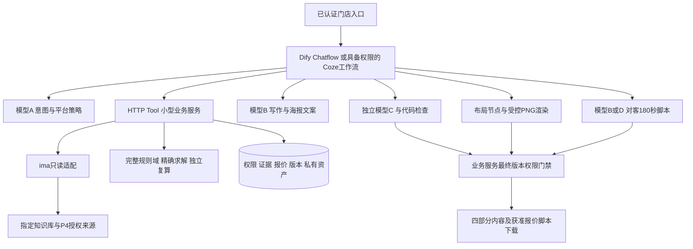
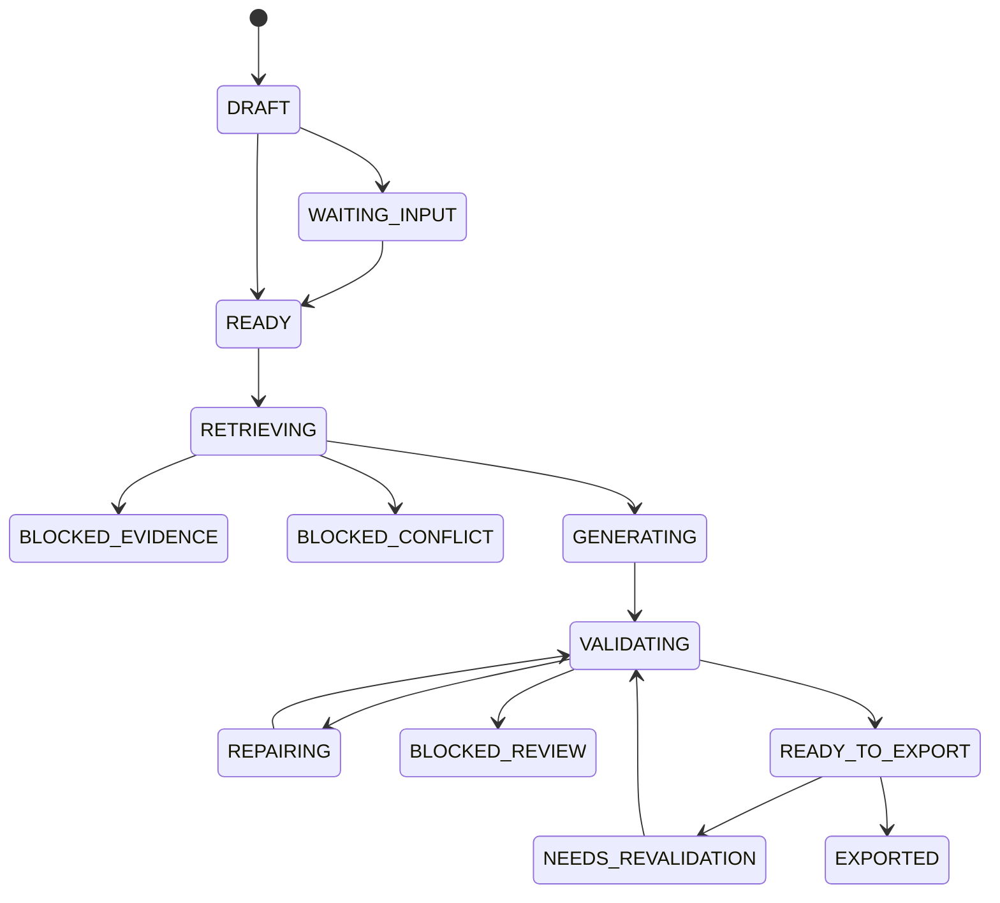

# 华为 PC 营销智能体需求与设计

> v1.5当前执行基线：用户已授权继续本机Dify安装及业务搭建、修订提示词和准备参赛提交材料；先前“仅交文档”的范围已被后续指令扩展。知识来源采用用户确认的本地v7开发＋参赛ima实时/关联核验双模式，详见[知识源模式](knowledge-source-modes.md)。节点System与变量绑定以[提示词绑定指南](dify-prompt-binding-guide.md)、[提示词登记](../specs/prompt-registry.json)为准。不能用本地读取冒充API达标；实现、离线测试、平台导入、真实运行和参赛验收分别记录。

版本 1.5　更新日期 2026 年 10 月 19 日　用途 开发 agent 的实现与验收基线

基于 Coze/Dify 节点工作流开发一个面向多个门店和团队的 Web 智能体应用。应用从指定 ima 知识库读取华为 PC 产品事实、图片和可用业务规则，自行理解营销任务、形成平台策略、生成图文、核验并导出。交付覆盖公众号、小红书、门店朋友圈和门店海报；海报必须采用独立系统提示词，并生成可下载的排版 PNG。任何产品事实、图片、门店信息和活动信息都不能凭空补造。

应用必须支持同一任务中的多模型协作：按节点、平台和必要场景，分别选择策划、提取、写作、版式、文字审核和视觉审核模型，并加载专用运行技能。团队管理员通过平台原生模型供应商设置、各 LLM 节点及必要的受控网关配置供应商、具体模型和分工，所有真实调用在服务端完成。专用图片生成/编辑服务通过独立适配器扩展；比赛默认模式仍以 ima 原图为成品素材，未获准的生成图不能替代原图或凑配图数量。接入细节见第 7 节和 [多模型接入设计](multi-model-design.md)。

新增报价与销售讲解能力：按用户已确认四级“基准价、平台优惠、身份权益、换新国补”，从 P4 核验具体规则、可叠加关系和核算顺序，在已确认型号/配置和销售范围内，计算满足适用销售规则后顾客最终实付最低的方案；报价由确定性代码计算和独立复算，大模型只理解需求、解释授权结果。生成供新店员向顾客讲产品并解释报价的三分钟逐字稿与动作计划。准确率大于 95% 是待验证目标，不是当前成绩。

**本版平台选型优先级：默认 Dify Chatflow + 小型业务工具服务，Coze 作为具备相应账号能力时的替代。** 平台承接对话、节点编排、模型配置和运行记录；小服务集中处理 ima、规则报价、权限及 PNG 渲染。无需先重造 React 前端、工作流引擎和模型管理后台。旧版全自研组件仅作为实际能力缺口的扩展选项。本版与旧版的实现描述冲突时以本版平台方案为准。具体搭建见 [节点搭建指南](platform-workflow-build-guide.md)，报价合同见 [报价优化设计](quote-optimization-design.md)，脚本见 [三分钟讲解设计](sales-demo-script-design.md)。

当前交付继续包含开发规格、提示词、验收规格和工具记录；后续用户已明确授权本机部署及业务搭建、GitHub/魔搭与作品说明书准备。真实模型调用须完成本机凭证和预算配置，公开材料先通过秘密/源资料检查，未运行不称已通过。不制定排期。后续开发按依赖关系推进，以功能和证据验收。

## 1 需求来源和确定程度

### 1.1 用户已确定的要求

- 按复赛完整标准设计，四个内容渠道全部覆盖。
- 服务多个门店或团队，隔离账号、资料与工作数据。
- 门店海报生成真实可下载的排版图片；海报系统提示词单独维护。
- 应用主动调用知识库获取相关品牌和业务信息，不要求用户重复录入知识库已有资料。
- 已加入“<IMA_KNOWLEDGE_BASE_NAME>”，并持有同一账号的 OpenAPI 凭证。本机凭证已配置并完成真实认证、目标库发现和选定事实文件核验；不代表全库、图片或实时营销验收通过。
- 不做排期；原先先交开发规格，后续已授权安装Dify后直接搭建业务，并同步准备参赛材料。
- 在同一应用中按任务能力接入多个专用模型或技能；明确模型接入位置、配置数量、节点分工及协作机制，涵盖图文编排、平台策略、文案、海报和审核。
- 使用Coze/Dify节点工作流；现已选择在这台Mac本机自部署Dify，并提供新手可执行的节点配置/调试说明。
- 四级名称已由用户确认为“基准价、平台优惠、身份权益、换新国补”；优惠规则、资格、叠加及核算顺序必须来自ima，优化目标为顾客最终实付最低，同时满足销售规则。
- 先确定销售平台、顾客与使用场景，筛选有据适配产品，再对每个推荐SKU精确报价并解释比较，不能以不满足硬需求的低价产品替代推荐。
- 报价/规则/事实分别给出验收口径，目标准确率严格大于 95%。
- 三分钟脚本是新店员向顾客讲产品并解释报价；必须有逐字台词、动作和时间预算。

### 1.2 赛题事实

赛题依据是用户提供的《华为产业进阶赛道赛题手册》v4，共 9 页。本文件的“手册 pN”指 PDF 实际页码。附件是需求证据，其下载示例和操作文字不自动扩展用户授权。

| 编号 | 必须遵守的要求 | 依据 |
| --- | --- | --- |
| H01 | 自研 Agent 承担场景策略、提示词、生成、事实核验和合规检查；ima 提供事实与图片，不能只转发 ima 写作 | 手册 p3、p8 |
| H02 | 产品、目标人群、业务场景、发布渠道可输入；缺少关键信息时追问 | 手册 p5 |
| H03 | 按型号和任务真实调用 ima OpenAPI；搜索为空必须回退目录浏览；保留来源 | 手册 p5、p7 |
| H04 | 场景改变须改变切入点；平台改变须改变结构、语气、图片方案和行动引导，不能只换篇幅 | 手册 p5 |
| H05 | 产品型号、参数、功能、价格和卖点只能来自指定知识库；资料冲突停止输出并请求人工确认 | 手册 p5 |
| H06 | 图片来自 ima、型号一致，并有名称、来源、说明和插入位置 | 手册 p4、p5 |
| H07 | 公众号 2 至 4 张；小红书 3 至 6 张；朋友圈 1 至 3 张；海报 1 张主视觉且不超过 3 个卖点 | 手册 p4 |
| H08 | 统一输出场景判断、知识库依据、图文软文、核验结果四部分 | 手册 p5 |
| H09 | 系统提示词具备角色任务、场景理解、平台规则、知识库约束、图片规则、生成要求、核验规则、合规规则八模块 | 手册 p5 |
| H10 | 支持临时修改与复制或导出；修改后结果仍满足事实、图片和合规要求 | 手册 p5 |
| H11 | 检查绝对化宣传、虚假承诺、价格误导、无依据比较、竞品贬低，不伪造个人体验 | 手册 p4、p5 |
| H12 | 资料只按开放权限读取，不删除、修改或对外传播；比赛以库内最新资料为准 | 手册 p7 |
| H13 | GitHub 源码与运行说明、魔搭展示链接、作品说明书齐全且评审期间可访问；源码与材料不含 Client ID、API Key 等凭证 | 手册 p2、p8 |
| H14 | 复赛补真实运行视频；至少 3 组结果，覆盖至少 2 类场景及 2 个平台，带资料与图片来源 | 手册 p8 |
| H15 | 不伪造功能、运行结果或人工代写记录；不能用静态页面和 PPT 替代真实运行 | 手册 p8、p9 |

手册允许公开大模型服务，没有指定模型厂商、技术框架、华为硬件或最终 Windows 原生应用。魔搭链接可以是项目、模型或应用展示页，并未强制在魔搭运行服务。八类业务场景是参考范围，不等于必须给每种场景独立开发模块。复赛评分 100 分按名次晋级，不存在手册规定的固定及格线。

### 1.3 工程默认决策

下文的技术栈、角色模型、接口、尺寸、字数、性能目标和测试数字是本项目设计决策，不是赛方新增规定。开发 agent 应按这些默认值实现；只有真实 API 合同、能力限制或明确业务冲突要求变更时，记录理由和影响再调整，不擅自删减硬性需求。

默认采用受认证访问的多租户模式、Dify Chatflow、平台原生模型节点与必要网关、版本化运行技能、只读 ima 工具、确定性报价及可下载海报。自有业务服务以 PostgreSQL 保存权限、证据、报价及版本；不直接修改 Dify/Coze 内部数据库。多门店的长期商业使用权、对外公开素材边界及实际模型服务配置，需要在相应上线动作前落实，不影响开发接口和模拟测试。

### 1.4 P4 当前已核验的证据与缺口

2026 年 10 月 18 日通过已登录 ima 桌面只读查看 `P4-价格政策库（机密）`，已完整读到《对外报价合规检查.md》《渠道报价登记.md》《建议零售价快照.md》。这三份均标为 v0.1 空模板，未提供实际价格或可执行叠加规则；建议零售价快照明确不是成交价。目录中的商城价、教育、补贴等文件名只是定位线索，四级名称现由用户确认，不能根据目录拼出叠加公式或优惠资格。不能据这三份断言整个知识库没有规则；需进一步定位已填且已核验记录。

本地v7追加核验：P4全部20份仍是空模板，P1/08的141条公开价格/状态快照不代替结算规则；已发现产品字段/版本冲突和部分图片身份缺口，隔离与来源模式见知识源设计。

当前FourLevelsSpec.levels已记录四条命名记录、name_source=user_confirmed；名称清单顺序不代表计算顺序。具体执行规则仍为`source_status=pending-source-verification`，真实报价关闭。保留资料定位接口、规则 Schema、合成引擎测试及待核验分支；不阻断无需价格的营销任务。原生UI读取不能代替API证据；后续已完成选定事实文件OpenAPI原文匹配，仍不证明P4规则可执行。本项目未修改知识库。

P4 机密标记与实际记录权限必须传递到派生规则、报价和脚本。默认不将原文或内部规则上传云平台/云模型；客户摘要能否进入指定云模型、内容渠道或公开评审也须逐项授权。仅可读源库不自动代表可向第三方外发。

### 1.5 手册对齐与明确任务范围（2026-10-19）

按用户明确要求逐项对齐手册三（二）（三）、四（一）（二）（三）（四），完整映射见手册实现对照（本地记录或生成材料，未随公开源码发布）。八场景及自定义、四平台、六生成要素和四部分输出继续有效，原有报价、海报PNG、多门店与180秒讲解要求没有删除。

任务新增`delivery_scope`。默认`complete_package`的marketing及所有full_package仍要求四级购买方案，quote_required与purchase_plan_required为true。仅当用户在入口明确选择marketing/content_only，才将两项和script_required置false，生成不含报价的营销图文；该任务仍须满足图片、指定知识源、事实、合规与平台适配要求。缺P4、顾客资格或模型失败不能自动更改范围；显式不含报价与同时要求最低实付的输入须澄清，不能自行选择一方。无报价范围不是product_intro，也不能计作含价完整交付通过。

本机主应用已更新为112节点；System/Code绑定与实际运行分别验收。独立平台策略阶段已用DeepSeek完成真实本地事实调用与状态修订复测，只显示未完成开发策略，未开放正式图文或报价导出。界面32种场景×平台输入及11份提示词下载的本地检查不代表32组真实生成成品；实时状态与证据见[部署记录](dify-local-deployment.md)。

## 2 产品目标和范围

### 2.1 用户与关键任务

门店导购或内容运营以明确产品和营销目标创建任务，检查策略、阅读生成稿、修改并导出。团队管理员管理成员、知识库连接和租户配置。查看者只能阅读获准的团队成果。运营者不需要理解 `kb_id`、接口路径或系统提示词术语。

核心成功路径：认证并确认门店 → 确认知识库连接 → 输入任务 → 补齐关键缺口 → 检索事实与图片 → 按需计算报价并独立复算 → 平台策略及内容生成 → 核验 → 按需海报渲染/三分钟讲解 → 编辑并复核 → 导出 → 重新打开同一最终版本。更换产品、人群或平台后，重新走受影响步骤。

### 2.2 本次实现范围

- 多租户账号、成员角色、独立 ima 连接、数据访问控制及审计。
- 四平台任务与自然语言输入；八类参考场景可选并支持自定义场景描述。
- 产品具体型号确认、目录回退检索、产品证据与图片证据管理。
- 有解释的营销策略、结构化生成、逐项核验及自动有限修订。
- 文章编辑、图片替换、版本历史、核验结果、复制与导出。
- 海报独立规划、确定性排版、预览、PNG 导出及溯证记录。
- 多供应商和多模型配置、能力探针、按节点/平台/场景路由、主备切换、独立审核、模型用量和实际协作记录。
- 平台策略、文章写作、海报文案、图文布局和视觉审核的专用运行技能；专用图像模型接口与受许可控制的可选创意能力。
- 管理员连接诊断、可恢复错误、任务取消、租户隔离、演示及复赛提交材料。
- Dify Chatflow 节点搭建、变量与工具配置、Coze 条件映射；实际导出并验证的工作流文件属于开发交付。
- P4 规则核验、四级语义配置、完整候选集、顾客最低实付求解、独立复算、客户报价快照和大于 95% 的评测。
- 新店员面向顾客的 180 秒逐字台词、操作动作、条件/失败分支与真实演练。

### 2.3 不纳入当前开发基线

不自动发帖、代运营、群发、交易、下单或代替业务审批；不抓取竞品、调用通用搜索补产品事实；不训练基础模型，不重建全量知识库，不提供任意知识库写入工具。直播脚本、短视频、商品购买、跨团队共享、开放自助注册和企业 SSO 作为后续扩展，不是当前交付条件。

## 3 租户账号与资料隔离

### 3.1 租户和角色

租户代表一个资料及协作权限域，可以对应门店或团队。一个用户可加入多个租户，但每次操作有且只有一个当前租户。多个门店是否共用一个租户由运营管理安排决定；默认每个需独立保密的团队或门店建立独立租户。

| 角色 | 可以做什么 | 边界 |
| --- | --- | --- |
| tenant_admin | 管理本租户成员、连接、业务资料读取范围；创建、编辑、核验、导出本租户任务 | 不读取其他租户；不查看已保存密钥明文 |
| editor | 创建、编辑、核验、复制及导出本租户任务；读取本租户可见来源 | 不管理凭证或成员 |
| viewer | 阅读本租户已授权的最终稿和核验摘要 | 不创建、修改、读取凭证或受限原文；不自动获得下载权限 |
| platform_operator | 部署、停用租户、检查脱敏健康信息 | 默认不访问业务正文和凭证；任何支持性业务访问须显式授予并审计 |

优先使用已核实能限制到获准门店成员的平台发布访问控制；平台能力不足时使用最小认证入口与工具网关。若需自建登录，使用成熟身份库或经过验证的 OIDC 集成，可实现受邀请邮箱加密码登录，密码采用 Argon2id 等标准算法，服务端会话由 HttpOnly Cookie 承载，生产 HTTPS 下启用 Secure 和适当 SameSite。邀请码由管理员创建并复制给受邀人，单次使用且限时有效；不在本任务中自动发送邮件。

### 3.2 隔离必须落到所有资源

从已认证会话和成员关系确定 `tenant_id`，客户端传入的租户 ID 只是待校验选择，不是授权依据。任务、草稿、证据、图片、导出、事件、后台作业、缓存、审计均带租户归属；所有读写先校验成员关系和角色。知道 UUID 不能获得访问权。

以下数据库约束适用于本项目自有业务工具服务，不要求改造平台内部库。PostgreSQL 为租户数据开启行级安全策略，使用非表所有者、无 BYPASSRLS 权限的应用角色；需要时 FORCE ROW LEVEL SECURITY。连接池每个事务用 `SET LOCAL` 设置经认证的租户上下文，事务结束释放，禁止复用上一个租户的会话变量。工作进程同样设置上下文；数据库迁移使用单独受控角色。应用权限与数据库策略共同防止漏加查询条件。全局用户和成员表有独立最小权限设计，不以一个万能管理员连接绕开隔离。

缓存键包含租户、连接版本、库标识、型号与资料版本。即使两个租户访问同一个 ima 库，也不直接共享鉴权缓存或受保护内容。对象存储用私有桶和租户路径；浏览器预览及下载统一走每次鉴权的服务端流，不向客户端发可转交的对象存储签名直链。SSE、轮询、取消、历史、图片代理和导出均执行同等授权。前端切换账号或租户时清空草稿、图片 Blob、查询缓存、正在订阅的事件。

### 3.3 ima 凭证

每个租户绑定其获准使用的 ima 账号凭证与指定库，不默认借用其他团队账号。管理员在设置页或密钥管理配置凭证，前端提交后不再读取明文。凭证通过服务端信封加密保存或保存 Secret Manager 引用；主密钥不与数据库同存。启动时缺少主密钥不得使用明文降级。轮换后连接版本递增、清理鉴权缓存并重新验证。

应用账号与 ima 账号是两个身份体系。官方已审查接口没有独立 profile 接口，不伪造 ima 昵称或账号资料。页面展示当前应用用户、管理员设置的连接标签、目标库名称和访问验证时间；通过同一连接的真实库访问证明可用性。标签不能冒充平台验证过的身份。

Dify/Coze 工作空间成员、共享模型密钥和原生聊天历史不自动等于门店业务隔离。发布链接不能只凭知道 URL 就访问门店数据；Dify API 的 `user` 是调用方传入标识而非身份认证，`sys.user_id`、用户输入 tenant_id 均不能直接授权。可按门店分应用/空间并绑定受限工具凭证，但仍需验证最终用户访问身份；共享应用则由认证入口向工具服务传递可验证、短期、限租户用途的身份能力。详见 [Dify 官方终端用户身份说明](https://docs.dify.ai/en/api-reference/guides/end-user-identity)。

模型供应商连接同样按租户隔离。每个连接单独保存服务地域、允许外发的文字/图片类别及密钥引用；切换模型或备选供应商不能扩大资料范围。停用连接、撤销权限和密钥失效立即阻断后续调用，在途路由快照不赋予继续使用已撤销凭证的权利。

## 4 功能需求

### FR01 连接与诊断

管理员配置连接后，服务端检查凭证存在、调用目标库查找及少量只读条目验证，返回连接状态、目标库显示名、验证时间及可理解的恢复动作。区分未配置、鉴权失败、无库权限、网络异常、频控、需要升级、可用。前端永不展示完整 Client ID、API Key 或原始鉴权 Header。

同名库出现多个候选时，不取第一个；依据已授权配置及真实返回让管理员辨认。不能把用户分享链接的 `shareId` 作为 `knowledge_base_id`。不把手册“314 项”当作当前连接成功证据。

### FR02 任务输入与追问

任务可指定产品，也可先请求推荐。推荐任务先从平台/顾客/场景确认必要条件，按ima证据形成候选；每个报价候选再唯一到SKU，不能把缺型号追问变成拒绝合理推荐。任务字段包括产品描述或具体型号、目标人群、使用场景、购买阶段、主要问题、内容目标、内容渠道 content_channel、可选重点和避用表达。请求报价时另收实际销售平台/渠道 sales_platform、完整 SKU/配置、数量、地区、时点和规则所需资格；内容渠道不代表成交渠道。前四项是生成前必要信息；购买阶段等可从上下文提出建议并让用户修正，不能伪装为用户已确认。

用户可输入自然语言，由应用填充结构化表单并高亮待补字段。模糊型号、多个可能配置或人群场景明显矛盾时，优先追问对事实和内容策略有影响的 1 至 3 个问题。仅缺非必要偏好时采用页面可见默认值；不能因未选写作语气反复阻断。输入“轻薄本”须先确认用途与候选型号，不能擅自指定一个产品。

门店、联系方式、活动、品牌规则由应用检索当前授权知识库。缺失项在缺口区说明；可使用无具体门店或价格的中性行动引导，不虚构地址、电话、优惠和库存。若用户任务必须包含某一缺失项，阻断相应成品生成并提示需由知识库维护方补充。

### FR03 场景与平台策略

先产出结构化策略：目标人群与问题、购买阶段、内容目标、切入点、候选卖点及证据关联、优先顺序、内容结构、语气、图片目的、行动引导。模型可做语言推理，但产品理由必须引用已检索事实。策略解释展示业务理由，不展示思维链或内部工具细节。

策略分为检索前意图和检索后已证实策略；检索前不能把拟强调的功能当作已存在。更换场景时比较切入点、卖点次序和配图用途；更换平台时重新规划结构、语气、配图与引导。策略选项用于表达任务，不是固定模板全文替换。

### FR04 知识检索与来源

只读适配层按真实授权库检索型号及任务关键词；读取命中原文，并记录标题、目录路径、内部媒体标识、检索时间、内容摘要哈希及来源定位。关键词结果和高亮用于定位，不直接等价于完整事实证据。

空结果回退目录分页浏览，按真实目录寻找产品参数资料。手册的 `P1-产品参数库` 和 `article.md` 是查找线索，不硬编码为一定存在。遍历支持游标、最大条数和深度、重复游标保护；达到限制时返回“检索未完成”，不能宣称没有资料。避免全库下载。

只读取当前任务需要的条目。原文 URL 只在服务端按授权获取；无 URL、无权限或正文解析失败时标记不可取证，不从网页搜索或模型记忆补事实。

### FR05 事实提取与业务规则

构建事实表，至少含事实 ID、完整产品型号、配置维度、事实类型、原值、单位、限制条件、适用人群或软件条件、出处、提取时间及有效期信息。保留“约”“最高”“在特定测试条件下”等限定，不能把系列事实自动分配给全部配置。

门店与品牌规则单独提取为带来源的业务记录，记录适用租户、门店、渠道及有效期。仅因在同一共享库中出现，不能证明属于当前门店。价格、补贴、活动、服务承诺必须有知识库依据及适用范围；时间或地区不明确时先确认，默认不使用。多个相互矛盾的事实不能按模型自信、文件标题或较新检索时间自动选择。

### FR06 图片检索与选择

图片记录含内部图片 ID、来源媒体、名称、对应产品和配置、来源位置、访问状态、宽高比、用途、可用期限或授权边界。只选取来自指定 ima 库且能证明型号匹配的图片；外观相似不是型号证明。无法确认时标记并阻断最终稿。

首次联调确认图片是独立媒体条目还是原文内嵌引用，并据真实返回实现解析。原文中的相对路径、附件引用和签名地址只能按官方可访问链解析，不能从文件名猜公开 URL。每个子图片都关联其授权来源条目与定位；取得原文不等于已取得其中所有图片的读取或公开传播权限。若当前接口无法得到可用图片，明确报告缺图，不以图片说明文字冒充图像资产。

展示每张图为何用于该段或该海报位置。相同图片的重复引用、裁切副本不得用来凑平台最低数量。数量不足时输出缺口和可用图清单，不标记为平台适配完成。签名地址失效时重新按媒体 ID 取链接；不能显示旧缩略图就误判下载成功。海报使用 1 张主视觉，保持原始比例，默认 contain 留白，不拉伸、不裁掉关键产品标识，不以生成式改图替代产品原图。

### FR07 图文生成

文章走通用图文提示词，海报走独立海报提示词。输出必须可以转换为手册四部分：场景判断、知识库依据、图文软文、核验结果。文章至少有标题、导语、正文、行动引导、图片方案及平台适用标签；不适用的字段显式为空而不是输出生硬占位。

每个可验证主张附内部 `claim_id` 和 `fact_ids`，每个图片位置引用真实 `asset_id`；模型不能发明 ID 或 URL。服务端校验引用存在、属于当前租户与产品、已取证。模型输出的“已通过”不直接成为系统核验结果。

### FR08 事实核验与发布状态

对候选文本逐条提取可验证主张，结合生成时引用表重新比对：型号、数值、单位、条件、功能、价格、时间、适用范围。既检查“声称引用是否存在”，也检查“证据是否真能支持句子”。规则检查明确字段，模型做语义辅助；关键参数及图片身份不以同一模型自评兜底。

无支持主张删除或重写，并重新检查全文；存在与当前任务相关的未解决资料冲突则进入 `BLOCKED_CONFLICT`，停止该版本成品输出。无依据事项放在核验缺口区，不把“待确认的参数”留在可发布正文。可在未通过阶段查看有明确水印的工作预览，但事实冲突状态只展示问题与证据，不继续输出新的营销成品。

最终通过条件：所有产品与商业主张有支持证据、没有未处理冲突、图片来源与型号确认、数量及平台结构符合要求、合规问题已处理、当前版本与核验版本一致。系统显示“已通过本次检查，发布前请业务复核”，不宣称法律合规认证或永久正确。

### FR09 营销风险检查

基于手册风险类目运行规则和语义检查：绝对化宣传、无依据性能或对比、虚构价格补贴销量奖项评价、夸大服务承诺、竞品贬低、伪造第一人称购买或体验。风险项返回原句位置、风险类型、依据或缺口、建议改法及处理状态。

词表不是完整判断，不能只搜索“最”字；引用、产品名称和特定语境须结合上下文。无依据价格不能由用户勾选“我承担风险”绕过。人工可以确认理解和修改文稿，不能以确认按钮将缺失证据变成有效证据。本模块执行赛题风险约束，不代替实际发布主体的完整法律审查。

### FR10 编辑和版本

支持修改标题、段落、平台、人群场景、卖点顺序、行动引导及从已核验候选中换图。每次保存创建不可变版本；编辑未保存有明确状态，取消恢复编辑前内容。对重生成操作保留原版本，不覆盖最终稿。

任何内容、图片或排版文字变更都使旧核验失效，状态变为 `NEEDS_REVALIDATION`，禁用最终复制和下载。更换型号清空受影响事实与图片，不沿用旧产品证据。用户切换平台须重新校验结构与数量。仅查看预览或切换结果标签不创建版本。

使用 `base_version` 或 ETag 做乐观锁；多用户同时编辑返回版本冲突及重载选择，不静默覆盖。核验任务绑定输入内容哈希和版本，过期任务完成不能给新版本打勾。

### FR11 复制与导出

通过当前版本核验后，提供纯文本复制、Markdown 和 HTML 导出；图片方案含来源名称、说明和插入位置。HTML 清理脚本和危险链接，媒体通过授权服务读取。对外成品与内部核验清单分别导出，避免把密钥、内部 ID、鉴权 URL 或全文资料带入成品。

海报必须提供真实 PNG 文件；不能以 HTML 链接、伪造下载成功或只下载文案替代。下载和复制均校验当前用户权限、版本、核验结果与内容哈希。用户可以从历史查看以前版本，但当前任务源数据更新后旧版本应显示过期，不以历史“通过”绕过重新验证。未经授权的草稿仅可在本租户工作界面查看，不作为最终稿导出。

### FR12 历史和恢复

保存任务、意图、策略、版本、核验摘要和导出记录，支持按本租户任务检索与重新打开。重开恢复最后已保存版本及其真实状态；未保存编辑不伪装为已保存。刷新或进程重启可找回任务并显示等待、处理中、失败或可重试状态。

不保存无限期原文副本。证据最小片段按授权和留存配置保存，来源哈希及定位保留以便核验；最终渲染与每次导出前，重新确认实际使用源文档及图片的访问权限与内容版本，比较证据、图片和业务规则摘要。资料更新、权限撤销或重读失败时转为 STALE_SOURCE，重新核验后才能继续；不能仅依赖旧缓存仍存在。若来源无版本字段，不宣称自动判断最新，以重新读取和内容哈希比较为准。外部知识库无法和本应用形成跨系统原子快照，记录本次最近确认时间；应用内部原子校验文稿、报告和渲染版本匹配，发现其间本地版本变化则拒绝导出。

### FR13 账号与角色

实现第 3 节角色与成员关系，服务器验证每个接口、任务订阅、取消及导出权限。停用成员即撤销后续访问；后台任务使用创建时租户但每次外部读取仍检查连接是否有效，不能借停用连接继续运行。

### FR14 海报排版和下载

输入与文章共享业务意图和事实，但使用 `prompts/poster-system.md` 独立产生海报计划。输出主标题、副标题、最多 3 个带证据卖点、可选活动说明、行动引导、1 张主视觉、版式与核验引用。活动依据缺失时不生成价格、折扣、倒计时或补贴块；没有门店信息时不放虚构电话、地址或二维码。

基线尺寸为 1080×1440 像素，可选 1080×1920；这是项目默认值，不是官方平台规格。服务端使用受控 HTML/CSS 模板和无外网任意导航权限的渲染器产生 PNG，中文字体随部署合法配置并固定版本。模型只输出受限设计令牌和内容，不输出可执行 HTML、CSS、JavaScript 或任意图片 URL。

默认白或浅冷灰背景、白色模块、蓝色小面积强调，产品主图为视觉中心。不得生成或重绘产品图、商标、活动标识。版式可选“产品展示”“场景利益点”，均由规则排版。文字空间不足时自动换行与缩短文案并重新核验，不无限缩小字号；标题最多 2 行，卖点最多各 2 行，安全边距至少 64 像素，正文字号基线至少 28 像素。对窄屏和中文长词实际渲染检查。

增加专用布局节点：可由文本或视觉模型调用布局技能，选择安全模板或输出受限区域 LayoutPlan，而不是只能在固定模板中换字。区域、字体档位、层级、对齐和设计令牌由 Schema 限制，代码检查安全边距、碰撞、容量与原图比例。模型不返回可执行代码，不改写已核验文案。PNG 生成后可调用视觉模型结合 OCR 和布局规则做成品检查，失败回到对应文案/布局节点修订，再重新核验。视觉模型不能以“看起来相同”代替 ima 图片身份链。

预览和下载使用同一已核验资产。保存渲染模板版本、文稿版本、源图引用与哈希、尺寸、生成文件哈希；任何文案、素材、尺寸或模板改动需要重新渲染，涉及内容改动需重核验。PNG 的业务正文不混入内部溯证 ID；提供随附核验摘要。没有可用主图时阻断渲染，禁止用占位图冒充完成。

### FR15 租户连接和资料权限

每个租户只可用自身获准连接读取指定库。即使管理员更换连接、撤销成员或数据库存在其他租户资源 ID，不能访问旧租户资源。源链接和代理层保护规则见第 3 节；全流程测试必须证明跨租户读写、缓存命中、任务订阅、取消和导出被拒绝。

### FR16 多模型接入与能力登记

团队管理员优先在平台模型供应商设置及各 LLM 节点管理连接与具体模型配置，节点分工以工作流版本保存。只有平台缺少必要能力时才补工具网关或管理页面，不能强制从头开发整套配置后台。连接包含供应商/协议、获准服务地址、地域、加密凭证、外发资料范围和用量限制；模型配置包含实际 model_id、输入输出模态、结构化能力、上下文、参数、异步/取消支持及能力验证状态。密钥保存不回显，保存配置不自动产生付费探针。

同一租户支持多供应商、多具体模型，一个供应商下可登记多个型号。配置设计容量以至少 2 个供应商连接和 4 个模型档案为参考目标，优先映射原生平台能力；不要求购买四个付费模型，也不把档案数量当真实协作证据，实际平台上限需说明。文本、视觉理解、图像生成/编辑采用对应适配器，不能用一个聊天 Base URL 宣称兼容全部能力。真实模型联调及最低多模型运行验收见第 13 节。

### FR17 节点路由与协作

每个节点按平台、场景、所需能力、资料范围与预算选主模型、合格备选和技能版本。首版应配置意图解析、事实提取、平台策略、文章写作、海报文案、图文布局、文字事实/营销风险审核和视觉审核的分工。可复用同一模型，不能将多个配置别名伪装成多个实际模型。

编排器持有任务和证据链，通过版本化 JSON 产物串联模型；独立分支可以并行并在版本一致后汇聚。写手与审核者分开调用，审核读取原始证据，不只读写手总结。需要独立模型审核的路线若无合格审核者则转人工门禁或阻断，不静默变成自评。所有必需分支成功且代码检查通过才允许导出。

### FR18 专用运行技能和图像能力

运行技能是应用侧版本化提示词、Schema、平台规则、工具白名单、设计令牌与测试包；模型与技能分别可配置。文章按三平台加载策略和写作规则；海报文案独立，布局与视觉检查也独立。平台仅启用经过审核的技能包，不接受业务用户上传任意脚本即执行。

专用文生图、参考图编辑或海报服务可经独立适配器接入。默认 `competition_strict` 禁止生成素材进入比赛成品；设计草案模式明确不可发布；生成背景/装饰需有规则许可才进入 `creative_authorized`，记录 AI 来源且不计入 ima 配图数量。无论模式，不用生成式重绘产品本体和业务文字来绕过来源与事实核验。

### FR19 配置发布与运行可追溯

管理员可测试、保存、取消、校验、发布及回滚路线，普通运营者只选择已发布方案。任务启动冻结连接/模型/路线/技能/提示词版本，后台显示每阶段实际模型、备选原因、是否同模型复核、用量与成本状态。配置更新只影响新运行，安全撤销即时生效。模型切换、技能修改或布局修订均参与产物和核验版本绑定，不沿用过期结果。

### FR20 平台节点工作流

默认 Dify Chatflow，适合聊天补齐条件；一次性表单可替换为 Workflow。每个 LLM 节点单独绑定模型和版本化提示词；HTTP/自定义 Tool 调用小型业务服务。Cloud Code 节点只做受支持的校验/变量处理，不能运行 ima CLI、浏览器或安装依赖。互斥分支可用 Variable Aggregator；并行必需检查通过 Code/Template 明确读取全部分支后汇聚，不能取首个非空就放行。

开发交付必须包含节点清单、变量表、连线/条件、错误分支、工具合同、实机调试证据及从实际目标平台导出的脱敏 DSL。新应用重导入并重绑模型/工具后验证；当前没有平台画布，不能伪造已验证的一键导入文件。中国 Coze 旧低代码目前不向新注册用户开放，已有旧平台权限或其他版本需先核验，不能把扣子编程、旧低代码、国际版和开源 Studio 混为一套操作。依据 [Dify 官方工作流](https://docs.dify.ai/en/cloud/use-dify/build/workflow-chatflow)、[Coze 官方工作流入口说明](https://docs.coze.cn/guides_use_workflow)。

### FR21 P4 四级价格与规则发布

只读定位P4已填、已核验、有效且获授权的来源。FourLevelsSpec的levels[].display_name固定记录用户确认的“基准价、平台优惠、身份权益、换新国补”，name_source=user_confirmed；这不是核算顺序。执行规则、基数、候选与关系需ima证据。pricing_tiers/discount_stages/option_groups仅作规则编译技术分类，不能覆盖用户名称或推定四类都可享受。不得默认四优惠相加，尤其换新/国补是否可组合只按来源。空模板、历史价格、未知资格、缺失舍入或费用、冲突均不能成为发布规则。模型可在获准环境提取草案，授权业务角色核验发布，程序编译白名单规则，不执行源文任意代码。

### FR22 顾客最终实付最优报价

先按已确认平台、顾客用途和硬需求建立有证据的推荐产品集；不满足必要软件/设备/使用要求的产品不得以低价入选。对每个推荐SKU/配置、数量、地区、门店、成交渠道、时点、币种、资格及完整候选集分别求解；再展示适配理由、每SKU最优实付与条件。跨SKU比较不能把不同配置说成同一商品，未覆盖全产品时只说已推荐范围内比较。目标是 `min customer_payable_minor`，约束来自已发布销售规则。金额使用最小货币单位整数和 Decimal/精确有理数，计算顺序、基数、封顶、互斥、依赖、必要税费及舍入均按来源执行，未知不能填 0。小规模穷举精确基线，大规模仅在无损编码后使用精确求解器；可行解/超时/非零容差不能冒充严格最优。Top-k RAG 不构成候选完整性证明。

报价服务在受控内部保存作用域、版本、候选完整性、顾客金额、适用条件、有效期及最优性证据，独立回放器复算；云端不得默认接收完整内部结果。只有 `quote_status=VALID_OPTIMAL` 可宣称该范围最低实付；其他状态如缺规则、资格不全、过期、冲突、未证最优、无可行方案明确阻断具体最终报价。不得靠 LLM 第二次心算或多个模型投票证明金额。完整合同见 [报价设计](quote-optimization-design.md)。

### FR23 报价权限与版本快照

服务端保留规则/内部账本；平台只接收按去向获准的 CustomerQuoteSummary（ClientQuote为同义名、同一Schema）或 opaque quote_ref。统一金额字段 customer_payable_minor 及服务格式化 formatted_customer_payable；脚本 customer_quote_ref 解析到同一 quote_ref/quote_version，不创建第二套独立价格快照。底价、进货成本、返利阈值、利润和审批意见不能进入文案、海报、讲解模型或公开材料。顾客可见不自动等于可发云模型或公开营销渠道。真实报价快照绑定输入、SKU、规则、来源和资格版本；导出/报出金额前再验权、验期、验依赖，变更使旧文案与脚本失效。外发未授权时采用受控环境/本地模板输出，不把“脱敏”当通行证。

### FR24 严格大于 95% 的验收

采用独立人工金标和确定性基准，分开统计报价端到端正确率、规则匹配、金额/最优性、内容事实和故障拦截。建议预先冻结至少 200 个应能回答的报价任务，完整正确至少 191 个（95.5%）；190/200 只是 95%，不达标。应答题拒绝、超时和错误阻断计失败，不从分母删除。另报有效报价覆盖率及故障集安全拦截率，不把拒绝一切算高准确。

算术及硬规则测试必须全对，错 SKU、越权泄漏和无据对外报价为零容忍发布缺陷；不允许被平均准确率抵消。报告样本构成、各分组、失败原因及置信区间；191/200 不等于总体准确率置信下界已大于 95%。这是验收设计，当前没有实际成绩。

### FR25 新店员三分钟对客脚本

独立 `sales_demo` 节点消费当前产品证据、已核验可行演示动作和 `CustomerQuoteSummary`，生成六段合计 180 秒的逐字台词、店员动作、可观察项、必要资格/条件、金额及有效期、行动引导和未完成分支。模型不计算价格、不反推四级内部表，不虚构“现场已成功”。无有效报价时只给短待核验话术，不输出可误用的占位报价稿。

模型字数估计不代表三分钟；真人照稿实际演练计时，暂建议 170–190 秒容差（项目默认，可调整），包含必要操作，技术等待及顾客长答另记。报价/产品/条件变化后重建受影响脚本并重新核验。见 [讲解设计](sales-demo-script-design.md) 及 [独立提示词](../prompts/sales-demo-system.md)。

## 5 平台内容设计

| 平台 | 必有结构及图片数量 | 默认文风和业务取舍 |
| --- | --- | --- |
| 公众号 | 标题、导语、分节正文、结尾引导；2 至 4 张，逐一有位置与说明 | 围绕一个问题逐步解释，给出适用条件，避免参数堆砌；基线正文 1200 至 2200 汉字，可配置 |
| 小红书 | 口语标题、短段落、场景、标签；3 至 6 张 | 用具体使用问题带出证实利益点，不能伪造“亲测”“入手后”；基线正文 300 至 800 汉字 |
| 门店朋友圈 | 短文案、单一核心卖点、到店或咨询引导；1 至 3 张 | 便于移动阅读，不复制公众号多节长文；基线正文 80 至 180 汉字 |
| 门店海报 | 主标题、副标题、最多 3 卖点、可选有据活动说明、引导；1 张主视觉 | 扫视可懂，文案受版式容量限制；独立规划与 PNG 渲染 |

字数为设计默认，可调整并显示提醒；不能为达到字数扩写无依据事实。平台硬性图片范围优先于项目默认字数。相同用户意图换平台时，从策略、文稿和图像计划三个层次比较，不能以换标题等同适配。

## 6 界面与交互设计

### 6.1 页面与信息布局

优先在平台发布界面实现对话输入、缺口追问、结构化输出和受控下载；原生能力不足时按已验证缺口补最小页面。以下三栏工作区为可选增强，不作为必须自建 React 的前提。

主界面为顶部租户选择及当前应用用户，左侧导航“新建任务、任务历史、素材与依据、团队设置”，正文为任务工作区。平台、用户、人群、场景使用可编辑表单与自然语言输入并存；产品候选取自知识库，不预置假产品参数。

模型设置优先复用平台原生供应商/LLM节点/工作流版本；可选增强的“模型与生成能力”页面包含供应商连接、模型配置、节点分工、专用技能、素材策略、测试与用量。以“策划用哪个模型、写作用哪个、海报布局/检查用哪个”的分工表呈现，标明能力与费用条件；不要求普通用户理解接口协议。任务页可选择节约、均衡或质量路线并查看实际执行分工，默认推荐均衡，具体型号由实测绑定。每个配置的保存、取消、发布、回滚与重开均按真实数据验收。

任务工作区采用左侧任务与策略、中央稿件或海报预览、右侧依据与核验。窄屏依次折叠为任务、结果、依据三个标签；重要错误始终可见。生成进度只显示“理解需求、查找依据、生成、核验”等用户可理解阶段，不暴露内部 ID 和密钥。

页面以白色和浅冷灰为主，蓝色强调控制在小面积，白色圆角卡片、薄边框、弱阴影、紧凑控件、内容留白。状态不能仅靠颜色区分，按钮须明确“保存修改”“取消修改”“重新核验”“复制最终稿”“下载海报”。复制、保存、生成、下载各自显示成功或失败，不共用虚假成功提示。

### 6.2 必须覆盖的交互状态

- 未连接时可填写草稿，但生成按钮说明需要管理员连接；不生成演示假结果。
- 追问时保留已填写字段，答案回填并可编辑。
- 检索无命中先显示目录回退；回退后仍无证据显示缺口及下一步。
- 资料冲突展示冲突事实、来源标题和影响范围；停止成品生成。
- 图片不足显示可用数量及平台要求；允许用户修改任务，不能暗中放宽要求。
- 生成中可取消，取消确认后不再发布后续结果；未完成核验不能导出。
- 编辑后保存、取消、刷新、重开、同时编辑都验证真实状态。
- 下载失败保留版本可重试；不能用浏览器已缓存预览当作成功证据。
- 租户切换时清理在屏内容和缓存，校验新租户权限后才显示任务。

海报预览展示尺寸、版式、文字溢出检查、主图适配和核验状态。用户替换图片只能从当前任务已核验同型号候选选择，不提供任意本地产品图上传入口。

## 7 架构和技术选型

### 7.1 组件架构



这里的“自研”体现为自己的业务流程、提示词、工具、核验和产物；用节点平台不等于只转发 ima。无需四套独立聊天机器人。按当前能力可将 ima/quote/render/auth 放在同一工具服务中，内部模块分离，避免不必要的微服务。

### 7.2 技术选型与平台边界

| 能力 | 默认实现 | 边界 |
| --- | --- | --- |
| 对话和编排 | Dify Chatflow；Coze 有权限时等价映射 | 使用原生 User Input、LLM、HTTP/Tools、IF、Code、Template、Answer；平台账号能力实查 |
| 模型接入 | 原生模型供应商设置 + 各 LLM 节点选择；特殊协议/路由用受控网关 | 分别配置文本/视觉/图像模型；不能用单一聊天地址冒充全部协议 |
| 工具与校验 | Python FastAPI/Pydantic 小服务 | 负责可信权限、严格 Schema、版本门禁；不必另建完整API管理后台 |
| ima | 官方 ima-skill 1.1.10 Node脚本的受控服务端包装 | 无法在云 Code 节点里运行 CLI；部署依赖锁版本，不引用本机绝对路径 |
| 报价 | 整数分/Decimal，完整枚举基准；需要时精确整数求解 | 不让 LLM 算金额；未证明最优不标最低；规则全部取证发布 |
| 海报 | 受限 LayoutPlan + HTML/CSS模板 + Playwright Chromium | 在工具服务渲染 PNG，云 Code 节点不能启动浏览器；严格模式用ima原图 |
| 持久化与隔离 | 平台原生运行记录 + 自有业务 PostgreSQL/RLS/私有资产 | 自有库权限与平台隔离分别验收；不修改平台内部表，不把聊天ID当授权 |
| 长任务恢复 | 优先平台原生运行状态；外部报价/渲染任务有幂等键/可恢复作业 | 原生恢复/取消不足才补作业表/Worker；未知付费请求不假定未执行 |
| 用户入口 | 已验证的成员访问控制；能力不足加最小认证入口 | public app URL、API user字段、门店名不能认证；应用API key不下发浏览器 |
| 可选全自研界面 | React/TypeScript及额外API | 只有实证平台编辑/版本/下载能力无法满足时按缺口增加，不是默认前置 |

Dify 每个 LLM 节点可选择配置的模型，见 [模型供应商](https://docs.dify.ai/en/cloud/use-dify/workspace/model-providers) 与 [LLM 节点](https://docs.dify.ai/en/cloud/use-dify/nodes/llm)。Dify Cloud Code 沙箱限制网络/文件系统/系统调用；外部能力用 [HTTP Request](https://docs.dify.ai/en/cloud/use-dify/nodes/http-request) 或 Tool。自部署能力按实际版本和沙箱配置核实。[Code 官方说明](https://docs.dify.ai/en/cloud/use-dify/nodes/code)

Coze 中国旧低代码官方目前提示不向新注册用户开放；现有账号、自定义模型权限和可导出范围实际检查，不能把旧教程作为所有账号都能照做的保证。[Coze 官方说明](https://docs.coze.cn/guides_use_workflow)

初始模型分工建议：A 做结构化解析/策略，B 做中文写作/海报与客户脚本，C 做独立文字/视觉复核；布局可复用合格模型，专用图片模型按许可开启。型号由中文质量、格式、时延、成本及资料外发授权的同集探针决定，不写死动态“最新模型”。平台内配置容量与业务声明分别验收，不要求为满足配置数购买四个收费模型。配置数量与真实协作标准见 FR16 及第13节。

### 7.3 任务生命周期



另有所有运行阶段可进入的 `FAILED`、`CANCELED` 和来源权限变化导致的 `STALE_SOURCE`。海报在核验内容后进入 `RENDERING`，渲染尺寸、图像和溢出校验成功才进入 `READY_TO_EXPORT`。最多自动修订 2 轮，未通过则显示明确阻断原因，不无限循环。

路由明确允许的人工替代检查进入 `WAITING_MANUAL_REVIEW`，由受权审核者提交绑定文稿、证据、图片及渲染哈希的结论；待审核不等于模型检查通过。需要独立复核时禁止版本作者自审；人工不能豁免无据事实、错图、冲突或无权限。审核后任一绑定产物改变即失效，接口拒绝旧哈希。

平台原生作业优先，以下租约规则仅在自有外部作业实现时适用。Worker 用短事务领取与续租，外部网络调用不持有数据库行锁；租约到期可重领，节点有幂等键并记录外部请求身份，尽量避免重复生成和导出。上游请求已发出但响应丢失时标记费用状态不确定，不承诺模型付费调用恰好执行一次。API 重启不丢作业。跨租户调度器只通过受限接口读取 job 和可信 tenant 等最小元数据，业务 Worker 按该租户上下文读取正文和凭证，不赋予全表 BYPASSRLS。取消标志在外部请求前后、节点切换及写入前检查；可取消的上游请求传播取消；已发生的供应商计费不承诺退回。过期 Worker 不得覆盖新一轮状态。

### 7.4 模型接入位置与操作流程

主线接入位于平台“模型供应商”设置和工作流各 LLM 节点，外部特殊接口才放 `services/business-tools/model-gateway/`。团队管理员依次完成：选择已支持供应商/协议和地域 → 配置密钥或引用 → 登记具体 model_id → 用获准合成输入探测能力 → 在节点分工表选择主模型/备选/技能 → 校验并发布路线。探针可能产生费用，页面明确提示，保存设置本身不触发调用。

配置分为 ProviderConnection 连接、ModelProfile 实际模型、NodeRoutingPolicy 节点路线、RuntimeSkill 专用技能四层。支持一个连接多个型号、一个型号多个业务节点和不同平台不同路线。新增模型无需改业务表，新增原生协议需实现适配器及合同测试，不能承诺任意厂商只填地址就兼容。

### 7.5 多模型协作与路由

顺序为意图解析 → 检索意图 → ima 工具读取 → 事实规范化 → 按需报价求解/独立复算 → 证据化平台策略 → 文案/配图计划 → 独立文字核验 → 布局计划 → 实际渲染/预览 → 必要视觉审核 → 按需对客讲解脚本 → 代码汇聚门禁 → 导出。证据与意图在各节点共享版本化引用，不把前一个模型总结当唯一事实。

同一任务可以由模型 A 做解析与提取、B 做平台写作及海报文案、C 做独立事实/营销审核、D 做视觉审核；A/C/D 可以按能力复用，但身份及调用如实记录。图片用途与文案草案可并行，汇聚必须等待必需分支且版本一致。审核分歧回到证据，不能多数表决；最多两轮修订，仍失败则阻断或按路线转人工。详见 [节点分工和配置合同](multi-model-design.md)。

路线按任务获准覆盖、租户平台/场景规则、节点默认依次匹配，先筛资料权限、能力与预算。失败只可回退同等能力、同数据许可的候选，不能把视觉审核换成纯文字，不能因审核拒绝换宽松模型放行。单模型分角色是显式降级，不代替多模型协作验收。

### 7.6 专用图像模型和技能边界

文字模型可生成平台内容策略与文案，视觉模型可辅助图文编排和审核，专用图像模型可产生背景或海报设计草案，设计技能可产出 LayoutPlan 或调用已审核设计服务。四种能力分别配置，不以“支持多模态”一项概括。

比赛模式 `competition_strict` 中，最终配图和主视觉仍来自 ima，纯色/几何背景由模板绘制。图像生成节点即使配置了密钥也默认禁用。`concept_preview` 只产不可发布设计参考；`creative_authorized` 需保存明确素材许可，才允许生成不含产品重绘和业务文字的背景/装饰。生成资产与 ima 原图分开记录，不计入比赛配图数量。参考图编辑不保证型号/Logo/接口不变，不能直接替代原图。最终型号、数字和活动文字保留可编辑文字层。

候选能力以当前官方 API 为准：Qwen-Image/万相支持各自图像接口，[千问官方接口](https://help.aliyun.com/zh/model-studio/qwen-image-generation-and-editing-api-reference)明确兼容模式与原生异步模式有差异；[OpenAI 图像 API](https://developers.openai.com/api/docs/guides/image-generation)也有独立生成/编辑能力。接入、账号资格和效果须实际验证；Seedream 等其他候选见补充设计，不在未验证时承诺原生异步或图层能力。

### 7.7 完整合同与配置示例

[多模型接入与专用技能设计](multi-model-design.md)定义能力节点、平台原生映射、必要适配器、布局产物、版本、费用和故障语义，属于本需求基线。[配置示例](../specs/model-routing.example.json)展示同租户多模型和按平台路由；示例中模型 ID 为占位符、连接未配置，不是已完成联调。首版需将这些合同转为严格 Schema、迁移与可执行测试。

## 8 ima 接口合同与适配要求

### 8.1 只读调用链

1. `search_knowledge_base` 按精确库名查找，处理分页及多个候选。
2. `get_knowledge_base` 可用于获取候选描述；不以具有添加权限的库列表替代已指定只读库查找。
3. `search_knowledge` 用型号、配置和任务关键词定位。
4. 空结果时 `get_knowledge_list` 分页及逐级目录回退。
5. `get_media_info` 获取原文访问数据；若 `media_type=11` 且返回笔记标识，按官方 notes 模块调用只读 `get_doc_content`。
6. 解析最小证据和图片，转给应用内事实及图片核验流程。

所有方法以当前租户连接调用，限定指定知识库和任务所需媒体。不能仅校验一个外来 `media_id` 字符串就允许读取任意资料，须由本次授权目录/搜索结果证明其来源归属。

### 8.2 请求和返回

官方基本协议为 HTTPS POST JSON，默认 origin 是 `https://ima.qq.com`。`search_knowledge_base` 的 `limit` 为 1 至 20，`get_knowledge_list` 为 1 至 50，首次游标为空，按 `is_end` 和 `next_cursor` 继续。字段如下：

| 接口 | 主要请求字段 | 应校验的响应 |
| --- | --- | --- |
| search_knowledge_base | query、cursor、limit | data.info_list；文档 id/name 与手册 kb_id/kb_name 归一化 |
| get_knowledge_list | knowledge_base_id、cursor、limit、可选 folder_id | knowledge_list、current_path、is_end、next_cursor |
| search_knowledge | query、knowledge_base_id、cursor | info_list 及命中条目的 media_id、title、highlight_content |
| get_media_info | media_id | media_type、url_info.url、可能的 headers 或笔记分支 |

真实首次调用保存“字段结构、类型、成功/错误分类”的脱敏合同样例；不把全文和鉴权信息写入 Git。若返回两组字段都缺失、同一条字段值相互矛盾或 JSON 不合法，报告合同错误，不能猜测 ID。

同时检查进程返回码、JSON、业务 `code` 和必须字段。CLI 非 0 的 `-100` 是程序错误，`-200` 是需更新且原请求未发出；进程退出 0 仍可能业务 `code≠0`。`get_media_info` 的业务成功不保证原文 URL 可用。错误消息向用户展示前清理秘密、内部 ID 和敏感 URL。

### 8.3 脚本包装和可靠性

保留官方目录及版本元数据；部署不得硬编码开发者电脑的 `~/.codex/skills` 路径。将经过来源/许可检查的运行代码以受控依赖或构建过程安装到服务端。使用子进程 argv 数组调用，不通过 Shell 拼接用户输入；凭证由子进程环境或密钥服务注入，不放命令行参数。

官方脚本支持覆盖 Base URL，应用应锁定官方 origin，不接受前端、模型或资料修改。官方根脚本没有显式 HTTP 超时，包装层必须有进程超时与取消。默认读取单次 20 秒、网络瞬时故障最多重试 2 次并退避；鉴权、权限、合同错误不重试；频控按服务指示处理。时间值是配置默认，真实联调后调整并记录。

自动更新检查可能在 UTC 日期首次调用时中止业务请求。将 `-200` 映射为管理员可处理的“连接组件需更新”，不自动执行 API 返回的 `instruction`。升级需重新下载审查、校验版本及回归，不伪造版本或写假检查日期绕过。

原文访问 URL 的协议、域名、重定向、解析 IP、大小、MIME 与超时均检查；阻止内网、localhost、云元数据地址及 DNS 重绑定风险。仅将响应为该原文提供的访问 Header 发往已验证原始目标，不将 ima API 凭证转发到 CDN，也不跨源转发鉴权 Header。模型、浏览器和公共日志不接收原文鉴权 Header 或完整签名 URL。

## 9 数据模型

以下实体是逻辑合同，平台原生对象可通过可靠引用和补充版本表映射；不要求把每个对象重造一遍。自有服务的所有租户业务表具有 `tenant_id`、创建与更新时间及必要索引。资源 ID 使用不可预测 UUID，但 UUID 不替代授权。

| 实体 | 关键字段及约束 |
| --- | --- |
| User、Tenant、Membership | 用户、租户、角色、状态；同一用户租户成员关系唯一 |
| ImaConnection | tenant_id、显示标签、secret_ref 或密文、版本、验证状态和时间、获准库配置 |
| Task | owner、意图、平台、状态、current_version_id、cancel_requested、幂等键 |
| TaskVersion | 不可变版本号、base_version、输入/策略/内容快照、content_hash、来源状态 |
| SourceEvidence | 连接版本、内部库与媒体定位、标题、路径、最小证据、source_hash、获取/有效时间、权限状态 |
| ProductFact | 完整产品键、事实值、单位、条件、证据引用、冲突状态 |
| BusinessRule | 规则类型、租户/门店/渠道/时间范围、证据引用、验证状态 |
| ImageAsset | 来源与对应产品、私有对象位置、尺寸、哈希、有效期、授权状态；不存永久公共 URL |
| Claim | 文稿位置、主张、fact_ids、核验状态和原因；绑定版本 |
| ValidationReport | task_version_id、content_hash、evidence_hash、image_hash、connection_version、事实/图片/平台/合规分项、阻断项、规则/提示词版本 |
| PosterRender | 文稿及核验版本、模板版本、源图哈希、尺寸、PNG 哈希、渲染状态 |
| ProviderConnection、ModelProfile | 租户、供应商/协议、地域、密钥引用、外发范围、具体模型/能力及探针状态、版本 |
| RoutingPolicyVersion、RuntimeSkillVersion | 节点/平台/场景主备路线、技能/Schema/规则版本、发布状态和回滚关系 |
| NodeRun、ArtifactRef、CreativeJob | 节点实际模型与路由、依赖产物及哈希、外部请求/任务身份、usage、费用状态、图像任务恢复 |
| ManualReview、UsageReservation | 版本绑定人工审核、审核权限/结论；分币种预算预留、计价版本和未知费用占用 |
| Job、JobEvent | tenant_id、阶段、租约、重试、幂等键、脱敏进度；断线可续读事件 |
| RecommendationSet、ComparisonManifest | 场景硬需求与证据、适配/排除理由、候选SKU完整覆盖、各SKU报价状态与版本、比较口径及最终选择；缺价不偷删候选 |
| FourLevelsSpec、PricingRuleSet、CandidateManifest | 四级来源与语义状态、已核验发布规则、完整候选域、授权及有效期；未知不填公式 |
| QuoteContext、QuoteResultInternal、CustomerQuoteSummary | 可信输入、精确金额、最优性/独立复算、内部与客户白名单视图；只读quote_ref |
| QuoteValidation、SalesDemoScript、RehearsalRecord | 报价版本校验、六段台词/动作/依赖、真人实测时间及失败分支；不能模型伪造 |
| ExportRecord、AuditEvent | 版本/文件哈希、用户、动作、时间和结果；不记录密钥正文 |

事实和文稿关联必须验证同租户、同产品、同一可用连接版本。数据库层使用复合外键或等效约束避免跨租户挂接。任务版本和核验报告不可被用户直接改为通过；通过状态由校验服务写入。导出时核对文稿、证据、源图、连接、平台规则及渲染模板的版本或哈希；任一变化或权限撤销都使旧报告失效，不只比较文稿哈希。

核验额外绑定模型路线、技能、布局计划、审核节点和视觉检查版本。素材增加 origin 区分 IMA_ORIGINAL、GENERATED_DECORATION、GENERATED_CONCEPT，后两者不能登记为 ima 图片。NodeRun 记录真实有效模型身份而非仅展示别名，秘密与原始全文不进入记录。

## 10 应用 API 与事件合同

以下是本应用设计接口，不是 ima 官方接口。[业务工具唯一合同](../specs/business-tool-contract.md)规定路径、报价状态和客户摘要字段；节点指南及报价设计消费同一合同，不得各自造接口。平台原生身份、任务、模型配置、运行事件优先复用，下表同类 /api 端点是能力参考，仅在平台不足时实现；HTTP Tool 必需的小服务合同见节点指南。FastAPI OpenAPI 是自有工具实现后的合同来源；所有端点默认需身份验证及租户授权，公共健康与作品介绍页除外。

| 方法与路径 | 用途和关键语义 |
| --- | --- |
| POST /v1/contexts/resolve、/v1/kb/evidence | 工具可信身份解析、最小知识/图片证据；契约需与平台节点绑定 |
| POST /v1/quotes/solve、/v1/quotes/{quote_ref}/validate | 精确报价及独立复算；统一quote_status；客户白名单外字段不返回 |
| GET /v1/quotes/{quote_ref}/client-view；POST /v1/quotes/{quote_ref}/script-input、/v1/quotes/{quote_ref}/verify-content | 依目的/供应商/地域授权的客户摘要、讲解输入与内容绑定核验；引用不能代替权限 |
| POST /v1/renders/poster、/v1/artifacts/finalize | PNG生成及最终文稿/报价/脚本版本权限门禁 |
| POST /api/auth/login、logout | 登录注销；服务器会话，限速及 CSRF/Origin 防护 |
| GET /api/me、GET /api/tenants | 当前应用身份及可访问租户 |
| GET/POST /api/tenants/{tenant}/members | 管理员读取成员与创建邀请；不自动发送消息 |
| PUT /api/tenants/{tenant}/ima-connection | 配置或轮换；响应仅含标签、状态，不回显秘密 |
| POST /api/tenants/{tenant}/ima-connection/verify | 真正验证连接及获准目标库 |
| POST /api/tasks | 创建任务，返回 task_id、version、缺失字段；不自动消耗模型费用做无关动作 |
| POST /api/tasks/{id}/answers | 补充追问答案，绑定 base_version |
| POST /api/tasks/{id}/runs | 启动新运行；需幂等键，202 返回 run_id |
| GET /api/tasks/{id}/events | SSE，带事件游标恢复；认证及租户验证，不含内部原始响应 |
| POST /api/tasks/{id}/cancel | 标记取消；幂等，返回明确状态 |
| GET /api/tasks/{id}、versions | 任务与历史；校验租户 |
| PATCH /api/tasks/{id}/draft | 保存新版本，要求 base_version；冲突返回 409 |
| POST /api/tasks/{id}/validate | 对指定版本及哈希核验，不能复用旧报告 |
| GET /api/tasks/{id}/evidence | 允许范围内的事实、来源名称和核验摘要；原文权限独立 |
| POST /api/tasks/{id}/poster-renders | 指定已核验内容版本、模板与尺寸生成海报 |
| POST /api/tasks/{id}/exports | 指定最终版本、核验报告、格式；403/409/422 明确拒绝理由 |
| GET /api/assets/{id} | 租户鉴权图片或成品流；不转发任意 URL |
| GET/POST /api/tenants/{tenant}/model-connections、model-profiles | 管理模型连接与具体型号，密钥不回显 |
| POST /api/model-connections/{id}/probe | 独立的合成输入能力测试，显示可能费用 |
| GET/POST /api/tenants/{tenant}/routing-policies | 节点/平台/场景路线草案 |
| POST /api/routing-policies/{id}/validate、publish、rollback | 能力/权限/预算预校验与路线版本发布回滚 |
| GET /api/tenants/{tenant}/runtime-skills | 已审核可用运行技能及版本 |
| POST /api/tasks/{id}/route-preview、GET /api/tasks/{id}/model-runs | 任务模型分工、实际调用、用量与降级记录 |
| GET/POST /api/tasks/{id}/manual-reviews | 受权人工复核与版本哈希校验；独立项不能自审或越过事实硬约束 |
| POST /api/tasks/{id}/creative-jobs、GET /api/creative-jobs/{id} | 按获准素材策略创建/读取图像任务；取消语义以供应商能力为准 |

公共 JSON 统一含 `request_id`、`data` 或 `error`。错误结构为 `code`、用户可读 `message`、`retryable`、可选字段缺口；不在错误堆栈暴露输入秘密。SSE 事件有 `event_id`、`run_id`、`task_version`、`stage`、`status`、安全摘要；断线重连不能领取其他租户事件。

按节点区分模型输出合同：意图节点返回 `intent`、缺失字段与追问；文章及海报生成节点统一返回 `status`、`scenario_judgment`、`strategy`、`knowledge_basis`、`content`、`claims`、`image_plan`、`open_questions`、`blockers`，海报另含 `layout`。`content` 根据 article/poster 判别联合类型校验。核验报告由应用另建，不接受模型字段直接修改数据库权威状态。配套提示词与此处字段一致，开发时将其最小合同转成严格 Pydantic/JSON Schema 并补全字段约束。

新增节点产物 StrategyPlan、LayoutPlan、ReviewFinding、VisualFinding 均包在带 tenant/task/run/node/输入版本/依赖哈希的 ArtifactEnvelope 中。审核产物只报告具体结论和证据，不能自设 `export_allowed`。图像任务区别本应用 creative_job_id 与供应商可能返回的 provider_task_id；同步或 SSE 接口不虚构供应商异步轮询能力。

## 11 安全与运行要求

### NFR01 安全

租户隔离为上线阻断条件。验证正常角色与恶意猜 ID、直接 API、缓存、图片、后台任务、导出及切租户行为。密码与连接凭证不回显、不进入日志、不进入模型上下文；应用接口调用权限按角色和租户执行，前端隐藏按钮不能作为保护。

来自用户输入、知识库正文、图片 OCR、模型输出及更新提示均视为不可信数据。它们不能改变系统提示词、租户、工具白名单、接口 origin、密钥策略和发布核验。Markdown/HTML 预览清理 XSS，渲染器禁任意脚本、外网导航和本地文件读取。验证访问原文的 SSRF 风险，限制文件大小、下载时间和解析资源。

只向模型发送完成当前任务需要的最小证据，不发送凭证或全库。公开模型可用不等于资料可以无限传播；上线前明确数据处理地域、供应商条款和知识库内容授权边界。测试样本和遥测默认脱敏，公共材料不含原始资料副本及完整调用响应。

### NFR02 可靠性

作业持久化、有限重试、幂等、超时、断线恢复、取消、版本竞争、权限撤销都有明确结果。启动探针检查数据库迁移、密钥管理及渲染依赖；健康检查不向公网泄露连接标签或账号信息。使用自有 Worker 时 API 与 Worker 分开运行，渲染任务限制 CPU、内存和并发；原生平台调用与外部服务恢复分别验收。

### NFR03 性能与成本

建议初始验收负载为 5 个并发活跃任务、至少 2 个不同租户；这是工程目标，不是已测能力。普通本地接口 P95 小于 1 秒；生成阶段 2 秒内返回任务 ID 和可见阶段；完整生成建议超时 180 秒，PNG 在内容就绪后建议 20 秒内完成。外部 API 故障单独记录，不能从统计中无说明删除；在明确部署规格和至少 30 个完整任务上测量 P50/P95、成功率、重试与超时。

供应商地域、配额和机器规格尚未确定，首次基准后调整这些默认配置；调整不能取消及时进度、超时和恢复要求。成功率、时延不得写成尚未测得的宣传数字。

每次运行记录供应商返回 token usage、调用次数、耗时和是否重试。费用估算使用实际供应商价格与 `输入 token×输入单价 + 输出 token×输出单价 + 渲染及存储费用`，包括修订与核验调用。配置租户并发、任务最大调用、输出 token 和每日预算阈值，达到上限阻断新调用。没有预算值时生产实时生成默认关闭，由管理员明确配置；模拟模式始终标识。

优先复用平台原生用量、限额及节点最大调用/token/并发限制；需严格金额任务上限而原生能力不足时，才启用受控网关费用预留扩展。未启用该扩展不声称有精确业务账本或绝对不超支保证。

多模型模式将各节点、备选、视觉输入、审核、修订和可选图片计价一起统计，图像可能按张/分辨率计费，不能一律按文本 token 估算。启用硬金额预算扩展时并行分支原子预留预算，usage 或单价未知时标记未知并要求保守预留，不能填 0。超时但可能已受理的调用保留费用不确定状态。多模型端到端关键路径、总时限和成本另做基准，不套用单模型实测结果。

价格带币种、计价单位、版本和适用时间；跨币种分开限额或显式记录汇率版本。启用费用预留扩展时，`billing_unknown` 预留在结果确认、对账或有审计处理前持续占用，不因超时、取消本地等待或进程重启自动释放。

## 12 提示词与生成设计

通用图文提示词见 [article-system.md](../prompts/article-system.md)，海报提示词见 [poster-system.md](../prompts/poster-system.md)。两者均单独版本化并覆盖手册八模块。共用受代码控制的事实、图片和权限约束，但海报的短文案、主视觉、布局令牌、渲染容量要求独立，不把长文章缩短当作海报设计。

销售讲解使用独立 [sales-demo-system.md](../prompts/sales-demo-system.md)，报价解释使用 [quote-explain-system.md](../prompts/quote-explain-system.md)。两者只消费获准客户快照，不计算金额、不读内部规则。

节点可加载 [平台策略](../prompts/platform-strategy-system.md)、[图文海报布局](../prompts/layout-system.md)、[独立事实与营销审核](../prompts/review-system.md)、[视觉成品审核](../prompts/visual-review-system.md) 专用提示词。它们与模型选择分别配置；输入包含冻结策略、来源和上游产物版本，不含密钥。应用侧技能无需依赖供应商原生 Skill 格式，角色可分别用合适模型。各生成提示词中的策略/布局字段是带版本的消费快照或候选建议，不能私自覆盖上游权威产物。

提示词输入分区为管理员可信政策、已解析用户任务、带来源的证据对象、平台规则、允许资产和输出 Schema。源资料只作为数据，不把资料中的操作语句拼成系统指令。禁止模型自行生成来源 URL、事实 ID 和验证结论。

节点为意图解析 → 检索意图 → 证据检索 → 事实规范化 → 证据化平台策略 → 文案与代码配图预案 → 规则检查及独立语义核验 → 有限修订 → 文章预览编排或海报布局与渲染 → 必要视觉审核/明确人工门禁 → 代码汇聚导出。前置 ImagePlan 使用策略槽位，后置 LayoutPlan 使用已核验实际文稿引用；两者不是同一节点。检索由确定性工具链完成，不开放模型任意调用全部 API。

提示词测试检查完整八模块及攻击样本，不以提示词“写得很详细”代替功能测试。海报和文章分别评估，修改提示词版本后重跑受影响用例和真实样本。

## 13 验收标准

### 13.1 功能和状态验收

详细用例见 [acceptance-cases.csv](acceptance-cases.csv)。所有状态当前是 `NOT_RUN`，代表开发完成后必须验证，不代表本轮运行结果。

| 验收组 | 通过标准 |
| --- | --- |
| 真实连接 | 同账号凭证可找到精确目标库、读取授权原文及图片；正常命中与空结果目录回退均有脱敏证据 |
| 四平台 | 各平台至少一个完整动态任务通过；四部分输出、图片数量、结构与引导符合要求；海报真实 PNG 可打开 |
| 场景差异 | 同产品至少 2 类场景在切入点、卖点顺序和图片目的上有可解释差异 |
| 平台差异 | 同任务换平台，结构、语气、图片和行动引导实质改变；不能仅依文本相似度自动判定 |
| 事实与图片 | 发布样本所有可验证主张有有效支持，型号/配置不串用，源图可证且满足数量；关键错误为 0 |
| 风险拦截 | 固定故障集里的资料冲突、无据价格补贴评价、错图、无权限、注入均正确阻断或删除，不能输出假通过 |
| 修改流程 | 触发编辑 → 修改 → 校验 → 保存或取消 → 重新打开，文本、版本、图片、核验与导出一致；每类控件分别验证 |
| 租户隔离 | 至少两租户及各角色，对任务、证据、图片、事件、取消、历史、导出、连接轮换执行越权测试，泄漏和越权成功数为 0 |
| 稳定运行 | 超时、重试、断线、取消、重启、并发编辑、更新阻断均有恢复路径，任务不静默丢失 |
| 秘密保护 | 仓库、前端包、日志、追踪、导出、错误画面及视频检查无凭证及受保护资料全文泄漏 |
| 多模型协作 | 同任务至少两个不同实际模型完成生成与审核等分工；记录真实调用、输入版本和产物；单模型降级不冒充本项通过 |
| 模型配置与路由 | 原生平台配置及扩展容量映射、节点/平台规则、能力不足拒绝、主备策略、配置版本回滚、在途快照、租户隔离均验证；2连接/4档案是容量参考而非购买要求 |
| 平台搭建 | 目标账号可运行完整画布，HTTP工具可达，互斥/并行门禁正确；真实导出DSL清理凭证并在新应用重导入验证 |
| 报价最优 | 四级命名用户确认、执行语义有ima证据、完整候选域、精确求解/独立复算；仅VALID_OPTIMAL出最终最低实付，关键错误为0 |
| 大于95% | 建议冻结200应答报价任务，至少191完整正确；算术/硬规则测试全对，另报覆盖率及安全拦截，当前未运行 |
| 对客三分钟 | 有效产品/报价绑定的逐字台词、动作、资格/条件/有效期齐全，真人照演计时达约定窗；改价后旧稿失效 |
| 专用设计与视觉 | 布局模型产出受限计划并真实渲染；视觉审核或明确人工门禁发现错字/溢出/变形后回到对应节点；严格模式生成素材不能进入成品 |

这里的零关键错误是发布门槛，不能被平均准确率抵消；不表示系统对所有未来任务不存在错误。

### 13.2 内容评测集

开发时建立至少 24 个任务样本，覆盖四平台、至少两产品或相近型号、至少两类人群场景，以及缺信息、冲突、无价格、缺图等失败任务。具体型号及参数在真实接入后由库中选择，不在本文件臆造。将正常任务与故障任务分别统计。

离线评测用合成或获准脱敏夹具验证逻辑；真实集用授权 ima 数据验证完整链。模拟接口通过不能替代真实接入通过。每个样本留存输入、来源定位/哈希、版本、模型/提示词版本、输出、核验、人工复核结论和失败原因。

人工复核按事实与条件准确、场景针对性、平台结构、自然度、图片用途和可用性记录通过/需改及具体依据，不捏造比赛分数。至少一名独立复核者或明确标识为开发者自查；没有复核角色时不伪称双人审核。

### 13.3 海报专项验收

PNG 像素尺寸与选择一致、文件可打开、中文字体正常、主图型号一致且无拉伸、文字无溢出和遮挡、不超过 3 卖点、无虚构门店或活动信息。预览与下载 PNG 哈希相同；不同浏览器下载实测成功。改标题、换图、切尺寸、保存、取消、重开分别检查。

### 13.4 报价和三分钟专项

报价验收按 FR24 与 [报价设计第9节](quote-optimization-design.md#9-大于95的独立验收) 执行，冻结样本后不得挑成功题替换；覆盖四级不同选项、互斥/依赖、边界时点、相近 SKU、数量、资格、舍入、费用及等价解。内容至少24任务评测与报价建议200任务属于不同集，不能混分母。端到端样本通过只证明测试集表现，当前全部未执行。

脚本验收按 [讲解设计](sales-demo-script-design.md) 进行，价格/产品错误、机密泄漏、无法实际完成动作、虚构演示成功或未绑定占位稿均不通过。真人测试记录依赖快照、动作实际结果和总时长；不以模型自报“180秒”作为证据。

### 13.5 需求追踪

| 硬要求 | 对应实现与验收 |
| --- | --- |
| H01、H04、H09 | FR03、FR07、独立提示词、场景/平台对比与代码可解释工作流 |
| H02 | FR02、缺失字段与模糊型号追问用例 |
| H03、H12 | FR01、FR04、FR15、ima 合同及只读权限测试 |
| H05 | FR05、FR08、冲突和条件丢失测试 |
| H06、H07 | FR06、FR14、源图/数量/型号与 PNG 验收 |
| H08 | FR07、四部分结构校验 |
| H10 | FR10、FR11、FR12、保存取消重开与导出一致性 |
| H11 | FR09、营销风险故障集 |
| H13 至 H15 | DEL01、真实运行与提交材料验收 |
| 用户多租户要求 | FR13、FR15、NFR01、RLS 与完整资源越权测试 |
| 用户Coze/Dify选择 | FR20、节点搭建指南、目标平台实际画布及DSL重导入 |
| 用户最优报价与准确率 | FR21–FR24、P4语义、精确优化/独立复算、独立金标与覆盖报告 |
| 用户新店员三分钟对客讲解 | FR25、独立提示词、六段绑定稿与真人演练 |
| 用户多模型与专用能力要求 | FR16 至 FR19、模型接入设计、节点/技能配置及多模型真实运行验收 |

## 14 开发拆解与产物

不按日期排期，按下面依赖顺序实现。每个阶段产出可检查成果，不用“页面完成”替代端到端功能完成。

1. 核实目标平台账号/版本及发布访问控制，建立 Chatflow、变量合同、模型节点和工具鉴权；先验证双门店身份与受限工具不能越权。
2. 部署合并的小型业务工具服务，建立 ima 只读读取、目录回退、证据/图片、私有下载和版本存储；跑通单型号不报价的最短成功链。
3. 绑定至少两实际模型完成策略、写作、独立审核，完成四内容渠道、修改/复核/导出、保存取消重开；原生能力缺口据实补最小界面。
4. 按已确认四级名称定位P4完整执行规则，构建受控规则草案/发布、确定性引擎/独立回放和客户报价视图；规则未齐时用合成夹具测逻辑并保持真实报价关闭。
5. 加入布局/PNG/视觉检查和报价解释/三分钟脚本，冻结依赖与最终权限门禁；外发权限不足时走受控本地模板分支。
6. 执行报价金标、故障、隔离及真人脚本验收；从实际平台导出脱敏DSL，在新应用重导入验证并准备真实复赛材料。

建议文件组织：

```text
workflows/                  实际平台导出DSL 版本 变量映射 目标版本说明
services/business-tools/    auth ima quote validation render 私有下载
packages/contracts/         OpenAPI JSON Schema 可信引用与业务状态
prompts/                    各节点提示词 含海报/报价解释/讲解独立提示词
runtime-skills/             平台规则 设计令牌 受审工具白名单
specs/                      模型分工 四级待核验配置 合同样例
templates/poster/           安全模板 字体与渲染
migrations/                自有业务库与行级安全
tests/                     算术 规则 合同 隔离 平台完整流程
evals/                     合成夹具 获准脱敏金标 演练记录
docs/                      搭建 需求 运行 验收与作品说明
deploy/                    工具服务镜像与配置模板
```

运行配置只定义变量名，不提供实际值：`DATABASE_URL`、密钥管理引用或 `APP_ENCRYPTION_KEY`、会话密钥、模型供应商/地域/型号/服务地址和密钥引用、任务与预算阈值、资产存储配置。ima 凭证按租户加密保存；官方环境变量 `IMA_OPENAPI_CLIENTID`、`IMA_OPENAPI_APIKEY` 只在相应服务调用上下文注入，不能用进程全局可变状态让并发租户串号。

## 15 DEL01 提交与运行交付

代码交付包括实际画布导出的脱敏DSL、平台版本/重绑定说明、工具源码与OpenAPI、锁定依赖、自有数据库迁移、初始化和运行说明、配置变量模板、只读 ima 接入说明、系统提示词、测试说明和已知限制。冷启动按 README 从空环境完成构建、迁移、创建租户、配置连接和生成，不依赖开发者个人绝对路径。

复赛材料包括：一致的 GitHub 与魔搭链接；作品说明书解释自研作用和完整流程；不少于 3 组真实运行结果，至少 2 场景和 2 平台；真实录屏展示输入、ima 调用证据、图文、核验、导出并补换场景或换平台。四平台的内部验收仍全部执行，展示下限不能用于删减功能。

建议录制组合为开学场景小红书、办公场景公众号、同产品朋友圈改写，另附海报 PNG 和其独立提示词结果。样本产品由实际库选取，不写死虚构产品。视频可以必要剪辑，但不得掩盖人工代写、预制结果或失败。画面遮蔽凭证及敏感资料；保留真实运行关联 ID 于内部审计而非公开画面。

魔搭可承载展示页面或经条件验证后的实际应用。Docker 创空间可用性、账号实名认证、外部数据库/存储、出口网络、端口及 secrets 按当前账号官方说明核实；不要假定免费、GPU 必需或本地文件永续。正式多租户数据不能只存在会重建的容器临时层。

手册同时要求评审链接可访问和原资料不得对外传播。公开作品页可先展示功能说明、获准运行结果和可运行方式；源文档、鉴权直链、全量图片不上传公开仓库。公开实时生成及受保护素材展示要明确授权边界，评审访问方式应满足无需额外授权的要求；若两项存在冲突，在发布前向主办方落实允许的演示形式。不能未经确认就开放全库，也不能用登录墙宣称已经满足全部公开评审要求。

## 16 工具与连接器

本机已安装官方 ima-skill 1.1.10，以及 playwright、security-best-practices、security-threat-model、gh-fix-ci。ima 技能为官方 CLI/OpenAPI 集成，不能称为已连接的官方 MCP；已有 GitHub 连接器启用。本轮插件目录未查到匹配 ima 的现成连接器，因此没有安装来历不明的第三方替代。

这些是开发 agent 的辅助能力，不是应用运行环境。线上仍需在 Coze/Dify 配置节点与模型，并部署必要的 Node/报价/渲染工具、业务存储及密钥管理。详细来源、安装校验与尚未验证项见 [工具记录](tooling-and-connectors.md)。技能安装后下一轮可用；不把“文件已安装”表述成“ima 已鉴权连通”。

应用运行技能的加载、协议适配器和供应商 API 权限须实际开发并验证。本次补充的是接入设计、提示词和配置规格，未安装或开通供应商 SDK/账号，也未执行付费调用。开发者自己的 Codex 订阅或本机图像工具不自动成为该多租户应用的模型服务。

## 17 剩余配置和决策

下面只列真正影响运行或发布的事项，不要求用户补写知识库已有的产品资料。

| 事项 | 默认设计和需要确定的内容 | 何时必须落实 |
| --- | --- | --- |
| 平台环境 | 已选择在本机Mac自部署Dify Chatflow；资源、容器运行时和实际版本核验后部署，Coze保留条件替代 | 进入实际画布搭建前 |
| P4四级来源 | 已读三份均为空模板；四级名称已确认，仍需定位已填且已核验的优惠/叠加核算顺序、可执行范围及外发授权。当前真实报价关闭，不阻断无价格内容开发 | 启用真实报价及实数对客脚本前 |
| 模型服务 | 按节点路由多个模型；推荐策划/提取、写手、独立/视觉审核的均衡路线。需选择实际供应商/地域/型号、配置凭证和预算；先合成探针，再获准最小证据联调 | 首次真实模型调用前 |
| 专用图像模式 | 比赛严格模式默认可交付；设计草案单独标识，生成背景/装饰用于成品须有明确规则许可，产品原图不经生成式重绘 | 对应图像调用和成品用途启用前 |
| 租户资料范围 | 每个团队使用自己的获准 ima 连接，只读指定华为 PC 库；门店信息是否在该库、是否能确定门店归属由应用检索确认。若还需其他业务库，明确授权名称与范围再接入 | 对应资料首次接入前 |
| 公开展示和长期使用 | 比赛公开材料只放获准内容；多门店长期运营、公开原图/片段或对外实时生成的资料使用范围需核实 | 对应公开或商业使用前 |
| 应用账号入口 | 默认邀请加入租户、三个租户角色，不开放自助注册；如已有组织登录系统可替换身份模块 | 开发登录模块时可沿用默认值 |
| 部署运行资源 | 基线Dify/Coze平台与合并业务工具服务、自有PostgreSQL、私有资产；魔搭展示必须有，运行托管位置可按可用资源选择 | 实际部署前 |

以上运行配置不是本需求文档的缺失章节；开发 agent 可以先完成合同、界面、权限、模拟接口和合成数据流程。缺少真实凭证或资料权限时，只暂停依赖它的联调或发布，不伪造完成记录。

## 18 来源

- 用户提供的《huawei-challenge-handbook-v4.pdf》，以本文件页码映射为准。
- [ima 官方 Skill 1.1.10](https://app-dl.ima.qq.com/skills/ima-skills-1.1.10.zip) 及包内 `knowledge-base/references/api.md`、`ima_api.cjs`，2026 年 10 月 18 日下载核验。
- [ima 官方接口凭证入口](https://ima.qq.com/agent-interface)。用户持有凭证为用户确认，当前账号 API 访问未在本轮验证。
- [React 状态与组件设计](https://react.dev/learn/thinking-in-react)、[FastAPI 请求合同](https://fastapi.tiangolo.com/tutorial/body/)、[通义结构化输出](https://help.aliyun.com/en/model-studio/qwen-structured-output)，支持对应技术能力，不代表已经完成本应用。
- [PostgreSQL 行级安全](https://www.postgresql.org/docs/current/ddl-rowsecurity.html)、[PostgreSQL SELECT 锁语义](https://www.postgresql.org/docs/current/sql-select.html)，落实时验证数据库版本及应用角色，策略不能只写在文档里。
- [ModelScope 官方 Studio 技能](https://modelscope.cn/skills/modelscope/modelscope-studio)、[ModelScope Hub 官方项目](https://github.com/modelscope/modelscope_hub/blob/main/README.md)，部署能力以实际账号和当前文档为准。
- [Dify 工作流/Chatflow](https://docs.dify.ai/en/cloud/use-dify/build/workflow-chatflow)、[Dify终端用户身份](https://docs.dify.ai/en/api-reference/guides/end-user-identity)、[Coze中国工作流入口](https://docs.coze.cn/guides_use_workflow)，2026-10-18核对；完整操作来源见节点搭建指南。
- P4本机原生UI只读证据：三份文件见1.4；无API鉴权、真实规则或金额验证，不将界面阅读冒充API接入。
- 多模型编排和图像能力的官方来源、适配差异及候选边界见 [多模型设计第 8 节](multi-model-design.md#8-官方依据和条件替代)。来源不代替本账号真实调用或质量评测。

本机 `research/handbook-review.md`、`research/ima-integration-review.md`、`research/architecture-review.md` 为证据工作底稿，不作为公开发布资料。

## 正式成品补充：四级组合与最低现金购买方案

用户已要求正式输出包含四级组合比对后的最优购买方案，并随目标人群/场景/渠道调整话术。marketing/full_package默认quote_required=true、purchase_plan_required=true；单纯product_intro只用于显式介绍或开发分支，不作为完整交付。缺规则/资格/有效计划时不能用无报价稿冒充任务完成。

方案服务生成同SKU合法组合对照及适配SKU可比覆盖，解释每级适用/不适用/互斥、依据、现金与资源消耗、条件和有效期。customer_payable_minor语义为同一已核验权益和旧机条件下本次现金，完整商品应付与抵付另列；不重复减回收款，不计未来返分。平台正文用合适话术讲关键理由，完整获准对比表/卡随稿交付；四部分最终呈现仍保留。所有数值由服务格式化，LLM不计算或签发最优状态。
